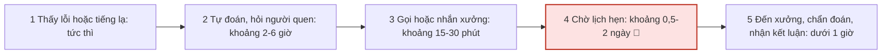
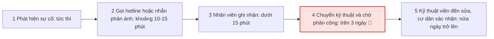
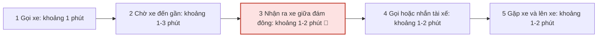

# Báo cáo cá nhân — 2A202603434_NguyenAnhTu

> Template và hướng dẫn: [docs/01-worksheet.md](../../docs/01-worksheet.md).

## 1. Thông tin học viên

- Họ tên: Nguyễn Anh Tú
- MSSV: 2A202603434
- Email trường (không bắt buộc, repo có thể để public):
- Tên nhóm: 7A
- Link repo nhóm: https://github.com/ThanhBinh101/K5-L3-Day02-NguyenThiThanhBinh-2A202603497-DiscoveryProblemFraming

---

## 2. Scan problem (CP1)

Lăng kính: **Lặp lại** · **Tốn thời gian** · **Cần đọc, tổng hợp nhiều thông tin** · **Pain từ người khác**.

**Cách tôi scan:** tôi bắt đầu từ các dịch vụ trong hệ sinh thái Vingroup mà tôi hoặc người thân đang dùng (xe VinFast, Vinhomes, Vinpearl, Xanh SM, trạm sạc, VinUni), rồi hỏi từng việc: lần gần nhất gặp là khi nào, mất bao lâu, ai khác gặp. Số liệu dưới đây là **ước lượng của tôi hoặc lời kể lại từ người quen, chưa đo bằng đồng hồ hay log**. Cột cuối ghi rõ nguồn của từng số.

| # | Lăng kính | Job Story: Khi… tôi muốn… để… | Ai chịu ảnh hưởng? | Dấu hiệu thật (thời gian, tần suất, số người, bằng chứng) |
|---:|---|---|---|---|
| 1 | Tốn thời gian | Khi xe VinFast báo lỗi hoặc có tiếng lạ, tôi muốn biết xe cần xử lý gấp hay có thể đợi, để quyết định có đi xưởng ngay không | Chủ xe, kỹ thuật viên | **Nguồn: lời kể của người nhà (chủ xe).** Từ lúc xe báo lỗi đến lúc biết nguyên nhân hoặc quyết định đi xưởng mất khoảng 1–3 ngày. Chưa đo, chưa biết xe báo lỗi gì |
| 2 | Cần đọc, tổng hợp nhiều thông tin | Khi đặt phòng Vinpearl cho cả nhóm, tôi muốn so sánh phòng, giá và ưu đãi ở một chỗ, để chốt nhanh mà không bỏ lỡ ưu đãi | Người đặt phòng, cả nhóm | **Nguồn: ước lượng của tôi.** Từ lúc bắt đầu tìm đến lúc chốt phòng thường dưới 30 phút; tính chung các việc trong bảng này tôi gặp khoảng 1–2 lần/tháng. Chưa đo |
| 3 | Pain từ người khác | Khi căn hộ Vinhomes có sự cố, tôi muốn biết phản ánh đã đến đúng bộ phận chưa và bao giờ có người xử lý, để không phải gọi lại nhiều lần | Cư dân, ban quản lý | **Nguồn: lời kể của một người quen là cư dân Vinhomes.** Từ lúc phản ánh sự cố đến lúc có người xử lý phải chờ trên 3 ngày. Chưa đo, chưa biết loại sự cố. **Bằng chứng công khai:** quy định xử lý yêu cầu của khách hàng do Vinhomes công bố (cập nhật 05/05/2025) ghi yêu cầu đơn giản được xử lý trong 4 ngày làm việc, yêu cầu phức tạp hẹn phản hồi chính thức trong 6 ngày làm việc, yêu cầu khẩn xử lý ngay khi tiếp nhận; thông tin gọi qua điện thoại được chuyển tới bộ phận xử lý trong 4 giờ làm việc ([nguồn 1](https://market-files.vinhomes.vn/public-mngt/d/279c2b19-3e4d-406a-950b-be78102f50fa)). Con số "trên 3 ngày" trong lời kể nằm trong khung cam kết 4 ngày làm việc |
| 4 | Lặp lại | Khi gọi Xanh SM ở điểm đón đông người, tôi muốn gặp tài xế nhanh, để không phải gọi hay nhắn chỉ vị trí | Hành khách, tài xế | **Nguồn: ước lượng của tôi (chính tôi gặp).** Từ lúc gọi đến lúc gặp được xe ở điểm đón đông thường mất khoảng 5–10 phút; tính chung khoảng 1–2 lần/tháng. Chưa đo. **Bằng chứng công khai (khớp một phần):** Xanh SM ra mắt tính năng "Chuyến đi ưu tiên – Xanh Priority" từ 30/07/2025, mô tả chính khó khăn khi đặt xe vào giờ tan tầm, trời mưa hoặc khu vực đông khách ([nguồn 2](https://www.greensm.com/vn-vi/news/tinh-nang-chuyen-di-uu-tien-xanh-priority-tren-xanh-sm)). Nguồn này nói về việc khó có tài xế nhận chuyến ở nơi đông khách, chưa nói trực tiếp về bước nhận ra xe ở điểm đón |
| 5 | Tốn thời gian | Khi cần sạc xe điện, tôi muốn biết trạm nào đang trống và bao giờ có chỗ, để không đến nơi rồi mới biết hết chỗ | Chủ xe điện | **Nguồn: ước lượng của tôi (chính tôi gặp).** Mỗi lần đến trạm hết chỗ phải chờ khoảng dưới 15 phút. Chưa đo. **Bằng chứng công khai (khớp một phần):** V-Green rút thời gian đỗ miễn phí sau khi sạc đầy từ 30 phút xuống 10 phút, với lý do tránh tình trạng xe sạc đầy vẫn chiếm chỗ ([nguồn 3](https://vnbusiness.vn/vinfast-rut-ngan-thoi-gian-mien-phi-do-sau-sac.html)). Nguồn này cho thấy việc chiếm chỗ ở trạm sạc là vấn đề được nhà vận hành thừa nhận, chưa cho số phút chờ |
| 6 | Tốn thời gian | Khi tìm thông tin học vụ ở VinUni (đăng ký môn, lịch thi, quy định), tôi muốn tìm đúng quy định mà không phải hỏi nhiều người, để không lỡ hạn | Sinh viên | **Nguồn: ước lượng của tôi.** Mỗi lần tìm lịch thi, quy định hoặc đăng ký môn mất khoảng 5–15 phút; tính chung khoảng 1–2 lần/tháng. Chưa đo |

**Nếu có dùng AI để gợi ý thêm:** AI (Claude) gợi ý danh sách 8 vấn đề trong hệ sinh thái Vingroup theo 4 lăng kính và viết khung Job Story. Tôi giữ lại 6 vấn đề mà tôi thật sự gặp hoặc biết người thân, bạn bè gặp. Tôi bỏ 2 ý (giấy ra viện Vinmec, điểm VinID hết hạn) vì tôi không có trải nghiệm và không biết ai gặp. Tôi cũng không để AI điền số liệu: các số trong bảng là của tôi hoặc từ lời kể, và đã ghi rõ nguồn. Sau đó AI tìm giúp các nguồn công khai ở dòng 3, 4, 5; tôi dùng chúng làm bằng chứng bổ sung (không thay cho số của tôi) và ghi rõ chỗ nguồn chỉ khớp một phần.

---

## 3. Top 3 Problem Cards + quy trình nháp (CP2)

### 3.1. Bảng chọn top 3

| Rank | Problem | Vì sao chọn | Điều còn chưa chắc |
|---:|---|---|---|
| 1 | Xe VinFast báo lỗi, khó biết nặng hay nhẹ (#1) | Khoảng thời gian dài nhất trong các dòng có số (1–3 ngày theo lời kể); quy trình có nhiều bước rõ; có yếu tố an toàn nên cần ranh giới chặt giữa phần máy gợi ý và phần người quyết định | Người nhà không nhớ xe báo lỗi gì; chưa tách được thời gian chờ lịch xưởng khỏi thời gian chủ xe phân vân |
| 2 | Phản ánh sự cố ở Vinhomes (#3) | Thời gian chờ dài (trên 3 ngày theo lời kể); nhiều bên chịu ảnh hưởng (cư dân, ban quản lý) | Chỉ có 1 nguồn kể lại; chưa biết loại sự cố nào chờ lâu và có khẩn cấp không |
| 3 | Gặp xe Xanh SM ở điểm đón đông (#4) | Lặp lại; chính tôi gặp; vẽ được quy trình ngắn | Mất 5–10 phút có thể chưa đủ đau để cần AI; có thể cải thiện bằng cách không dùng AI |

**Vì sao không chọn 3 dòng còn lại:** Vinpearl (#2), trạm sạc (#5) và VinUni (#6) đều chỉ mất dưới 30 phút một lần và tần suất thấp (1–2 lần/tháng tính chung), nên khó chứng minh tác động. Riêng #5 và #6 tôi chỉ có ước lượng của chính mình, chưa có người thứ hai xác nhận.

### 3.2. Chấm nhanh theo 5 tiêu chí chọn top 3 (1–5, tự chấm, có thể điều chỉnh)

| Problem | Actor rõ | Vẽ được quy trình | Bottleneck cụ thể | Impact đo được | Vừa sức một buổi lab | Tổng |
|---|---:|---:|---:|---:|---:|---:|
| #1 Xe VinFast báo lỗi | 4 | 4 | 3 | 3 | 4 | 18 |
| #3 Phản ánh Vinhomes | 4 | 4 | 3 | 3 | 3 | 17 |
| #4 Xanh SM điểm đón đông | 4 | 5 | 3 | 2 | 5 | 19 |

Ghi chú: điểm "Bottleneck cụ thể" và "Impact đo được" đều thấp hơn mức tối đa vì các số tôi có là lời kể hoặc ước lượng. Card #4 tổng điểm cao nhất do dễ làm, nhưng tôi xếp card #1 làm rank 1 vì thời gian chờ dài nhất và bài toán gần với những gì nhóm đã làm ở lab trước. Đây là lựa chọn của tôi, không chỉ theo tổng điểm.

### 3.3. Problem Card #1 — Xe VinFast báo lỗi

| Trường | Nội dung |
|---|---|
| Job Story | Khi xe VinFast báo lỗi hoặc có tiếng lạ, tôi muốn biết xe cần xử lý gấp hay có thể đợi, để quyết định có đi xưởng ngay không |
| Actor | Chủ xe VinFast (người nhà tôi), kỹ thuật viên ở xưởng |
| Thời điểm / bối cảnh | Khi đang dùng xe hằng ngày và xe báo lỗi hoặc có tiếng lạ, chưa rõ có an toàn để tiếp tục lái không |
| Quy trình hiện tại (3–7 bước) | 1. Thấy đèn báo hoặc nghe tiếng lạ (tức thì) · 2. Chủ xe tự đoán, tra cứu hoặc hỏi người quen (khoảng 2–6 giờ) · 3. Gọi hoặc nhắn xưởng để hỏi (khoảng 15–30 phút) · 4. Chờ lịch hẹn kiểm tra (khoảng 0,5–2 ngày) · 5. Đến xưởng, kỹ thuật viên chẩn đoán và chủ xe nhận kết luận (dưới 1 giờ, theo lời kể) |
| Bottleneck (bước nào, mất bao nhiêu phút) | Bước 2–4: từ lúc thấy lỗi đến lúc có người đánh giá, khoảng 1–3 ngày theo lời kể. Giới hạn: chưa tách được trong 1–3 ngày đó bao nhiêu là chờ lịch xưởng, bao nhiêu là chủ xe phân vân |
| Impact (nếu không giải thì sao) | Chủ xe không biết xe có an toàn không nên có thể lái tiếp khi không nên (rủi ro an toàn), hoặc đi xưởng gấp khi không cần (tốn thời gian và chi phí) |
| Success metric (baseline → target) | Baseline: khoảng 1–3 ngày (lời kể, chưa đo). Target đề xuất: quyết định "đi xưởng ngay" hay "có thể đợi" trong vòng vài giờ. Cách đo: thời gian từ lúc báo lỗi đến lúc chủ xe có quyết định, do chủ xe tự ghi. Target là đề xuất, chưa kiểm chứng |
| Phương án không dùng AI | Bảng tra mã lỗi và đèn báo trong sổ tay hoặc ứng dụng, kèm quy tắc cứng: đèn phanh, pin cao áp, túi khí thì dừng xe và gọi cứu hộ |
| Giả thuyết về AI (nếu có) | AI đọc mô tả triệu chứng của chủ xe và gợi ý mức khẩn cấp để chủ xe tham khảo; kỹ thuật viên vẫn là người kết luận |
| Cảm nhận nhanh | Rule + Workflow (rule cứng cho nhóm lỗi an toàn, AI gợi ý cho phần còn lại) |

**Ghi chú thêm:**
- **Ranh giới đề xuất:** AI không kết luận nguyên nhân chắc chắn, không báo giá, không bảo xe "an toàn để chạy tiếp" với nhóm lỗi an toàn.
- **AI sai kiểu nào tệ hơn:** bỏ sót lỗi nguy hiểm tệ hơn báo nhầm (báo nhầm chỉ tốn một chuyến đi xưởng).
- **Cần thêm để kiểm chứng:** hỏi lại người nhà xe báo lỗi gì và đã chờ bao lâu ở từng bước.

Quy trình nháp hiện tại (tổng 1–3 ngày theo lời kể; thời gian bước 2–4 là ước lượng chia từ tổng đó, bước 5 theo lời kể, chưa đo; 🔴 là bước nghẽn):

### 3.4. Problem Card #2 — Phản ánh sự cố ở Vinhomes

| Trường | Nội dung |
|---|---|
| Job Story | Khi căn hộ Vinhomes có sự cố, tôi muốn biết phản ánh đã đến đúng bộ phận chưa và bao giờ có người xử lý, để không phải gọi lại nhiều lần |
| Actor | Cư dân Vinhomes (người quen của tôi), nhân viên ban quản lý tiếp nhận |
| Thời điểm / bối cảnh | Khi căn hộ có sự cố (ví dụ hỏng thiết bị, rò rỉ) và cư dân cần người đến xử lý |
| Quy trình hiện tại (3–7 bước) | 1. Cư dân phát hiện sự cố (tức thì) · 2. Gọi hotline hoặc nhắn qua kênh phản ánh (khoảng 10–15 phút) · 3. Nhân viên tiếp nhận và ghi nhận (dưới 15 phút) · 4. Chuyển cho bộ phận kỹ thuật và chờ phân công người xử lý (nhiều ngày, trên 3 ngày theo lời kể) · 5. Kỹ thuật viên đến sửa và cư dân xác nhận xong (nửa ngày trở lên) |
| Bottleneck (bước nào, mất bao nhiêu phút) | Bước 4: từ lúc ghi nhận đến lúc có người xử lý, trên 3 ngày theo lời kể. Giới hạn: chưa biết sự cố trong lời kể là loại gì và có khẩn cấp không |
| Impact (nếu không giải thì sao) | Cư dân phải theo dõi và gọi lại nhiều lần; sự cố kéo dài; cư dân mất tin tưởng vào dịch vụ |
| Success metric (baseline → target) | Baseline: trên 3 ngày (lời kể, chưa đo). Target đề xuất: thời gian cam kết theo từng mức khẩn cấp. Cách đo: thời gian từ lúc phản ánh đến lúc có người xử lý, lấy từ dấu thời gian của phiếu phản ánh. Target là đề xuất, chưa kiểm chứng |
| Phương án không dùng AI | Cho cư dân thấy trạng thái phản ánh trong ứng dụng (đã nhận, đã phân công, dự kiến đến) và quy định thời gian xử lý theo mức khẩn cấp |
| Giả thuyết về AI (nếu có) | AI phân loại mức khẩn cấp và đúng bộ phận từ nội dung phản ánh; nhân viên duyệt trước khi chuyển |
| Cảm nhận nhanh | Rule hoặc Workflow (phân loại có nhãn cố định) |

**Ghi chú thêm:**
- **Ranh giới đề xuất:** AI không tự đóng phiếu, không tự hứa thời gian xử lý với cư dân.
- **AI sai kiểu nào tệ hơn:** gán sai mức khẩn cấp cho sự cố thật sự khẩn (ví dụ rò nước) tệ hơn gán nhầm khẩn cấp cho việc nhỏ.
- **Bằng chứng công khai:** quy định của Vinhomes (cập nhật 05/05/2025) ghi yêu cầu đơn giản xử lý trong 4 ngày làm việc, phức tạp hẹn phản hồi trong 6 ngày làm việc, khẩn xử lý ngay ([nguồn 1](https://market-files.vinhomes.vn/public-mngt/d/279c2b19-3e4d-406a-950b-be78102f50fa)). Vì vậy "trên 3 ngày" có thể nằm trong cam kết chứ không hẳn là làm sai quy trình; điểm cần xem là cư dân có biết mình thuộc mức nào và đang ở bước nào hay không.
- **Cần thêm để kiểm chứng:** hỏi người quen loại sự cố, số lần phải gọi lại và có tin nhắn hay ảnh chụp làm chứng không (che tên).

Quy trình nháp hiện tại (bước 4 và bước 5 theo lời kể và lựa chọn của tôi, bước 2 là ước lượng, chưa đo; 🔴 là bước nghẽn):

### 3.5. Problem Card #3 — Gặp xe Xanh SM ở điểm đón đông

| Trường | Nội dung |
|---|---|
| Job Story | Khi gọi Xanh SM ở điểm đón đông người, tôi muốn gặp tài xế nhanh, để không phải gọi hay nhắn chỉ vị trí |
| Actor | Hành khách (chính tôi), tài xế Xanh SM |
| Thời điểm / bối cảnh | Khi đứng ở điểm đón đông người (cổng trường, trung tâm thương mại) và gọi xe |
| Quy trình hiện tại (3–7 bước) | 1. Mở ứng dụng, chọn điểm đón, gọi xe (khoảng 1 phút) · 2. Chờ xe đến gần (khoảng 1–3 phút) · 3. Xe tới nhưng khó nhận ra giữa nhiều xe (khoảng 1–2 phút) · 4. Gọi hoặc nhắn tài xế để chỉ vị trí (khoảng 1–2 phút) · 5. Gặp xe và lên xe (khoảng 1–2 phút) |
| Bottleneck (bước nào, mất bao nhiêu phút) | Bước 3–4: nhận ra xe và phối hợp vị trí, khoảng 2–4 phút trong tổng 5–10 phút (ước lượng; bước 3 và bước 4 cộng lại). Giới hạn: chưa bấm giờ từng bước nên chưa biết bước nào thật sự mất lâu nhất |
| Impact (nếu không giải thì sao) | Mất vài phút mỗi chuyến, tài xế có thể hủy chuyến vì không tìm thấy khách; ảnh hưởng nhỏ nhưng lặp lại |
| Success metric (baseline → target) | Baseline: khoảng 5–10 phút (ước lượng, chưa đo). Target đề xuất: dưới 5 phút. Cách đo: thời gian từ lúc gọi đến lúc lên xe, lấy từ lịch sử chuyến trong ứng dụng. Target là đề xuất, chưa kiểm chứng |
| Phương án không dùng AI | Hiển thị điểm đón cố định kèm ảnh và hướng dẫn trong ứng dụng (ví dụ "cổng số 2, cột biển xanh"), thêm biển số và màu xe lên màn hình |
| Giả thuyết về AI (nếu có) | Có thể không cần AI: vấn đề chủ yếu nằm ở chỉ dẫn điểm đón, không phải dự đoán hay sinh nội dung |
| Cảm nhận nhanh | No AI hoặc Rule |

**Ghi chú thêm:**
- **Vì sao đưa vào top 3 dù có thể không cần AI:** đề chấp nhận kết luận No AI nếu lập luận chặt, và card này là ví dụ đối chiếu cho hai card còn lại.
- **Giải pháp đã có:** Xanh SM có tính năng "Chuyến đi ưu tiên – Xanh Priority" (từ 30/07/2025, phụ thu 3.000 VNĐ/lượt) để có tài xế nhanh hơn ở giờ cao điểm hoặc khu đông khách ([nguồn 2](https://www.greensm.com/vn-vi/news/tinh-nang-chuyen-di-uu-tien-xanh-priority-tren-xanh-sm)). Tính năng này giải bước chờ tài xế nhận chuyến, chưa giải bước nhận ra xe ở điểm đón đông, nên khoảng trống vẫn còn.
- **Cần thêm để kiểm chứng:** bấm giờ từng bước ở lần đi sau, đếm số lần phải gọi tài xế trong 10 chuyến gần nhất.

Quy trình nháp hiện tại (tổng 5–10 phút là ước lượng của tôi, thời gian từng bước chia từ tổng đó, bước 5 theo lựa chọn của tôi, chưa đo; 🔴 là bước nghẽn):

### 3.6. Card muốn pitch nhất

- Card số: 1 (Xe VinFast báo lỗi)
- Vì sao: Card 1 có thời gian chờ dài nhất trong các dòng tôi có số (1–3 ngày theo lời kể), quy trình vẽ được thành nhiều bước rõ, và có rủi ro an toàn nên cần ranh giới chặt giữa phần máy gợi ý và phần người quyết định. Đây cũng là bài toán tôi và nhóm đã làm ở lab trước nên tôi nói được sâu nhất.
- Câu hỏi muốn nhóm phản biện: Nếu AI chỉ gợi ý mà chủ xe vẫn tự lái tiếp khi xe có lỗi an toàn, ai chịu trách nhiệm và làm sao rule cứng chặn được?

### 3.7. AI đã phản biện card thế nào

Tôi dán 3 card cho AI (Claude), đóng vai PM hoài nghi, và AI chỉ ra các điểm yếu dưới đây. Cột "Đã sửa gì" ghi các chỉnh sửa đã thực hiện trong card ở trên.

| Điểm yếu AI chỉ ra | Đồng ý? | Đã sửa gì |
|---|---|---|
| Card 1: baseline "1–3 ngày" chỉ là lời kể của người nhà, và gộp cả thời gian chờ lịch xưởng với thời gian chủ xe phân vân, nên bottleneck chưa rõ là bước nào | Đồng ý | Tách bước 2–4 trong quy trình, ghi giới hạn chưa tách được chờ lịch xưởng và phân vân; ghi rõ "theo lời kể, chưa đo" |
| Card 2: chỉ có 1 nguồn kể lại, không biết loại sự cố; "trên 3 ngày" có thể do sự cố không khẩn nên chưa chắc là vấn đề của quy trình | Đồng ý | Ghi giới hạn nguồn (1 người kể, chưa biết loại sự cố và mức khẩn cấp); thêm mục "cần thêm để kiểm chứng" |
| Card 3: mất 5–10 phút có thể chưa đủ đau; cải thiện chỉ dẫn điểm đón (không dùng AI) có thể đã đủ, nên chưa cần AI | Đồng ý | Đổi "cảm nhận nhanh" thành No AI hoặc Rule, ghi phương án không dùng AI cụ thể |
| Cả 3 card: target (xuống dưới 5 phút, vài giờ) là con số đề xuất, chưa có cơ sở | Đồng ý | Ghi rõ "Target đề xuất, chưa kiểm chứng" ở cả 3 card và nêu cách đo |

---

## 4. Tôi đã tham gia phần nào (CP3 → CP7)

| Hoạt động | Tôi đã làm gì? | Kết quả / ảnh hưởng tới bài nhóm |
|---|---|---|
| Pitch Problem Card | Tôi pitch card 1 (xe VinFast báo lỗi, khó biết nặng hay nhẹ) | Card của tôi là một trong các card nhóm cân nhắc; nhóm sau đó ghép và sửa từ nhiều card để chọn candidate |
| Phản biện bài của bạn khác | Tôi hỏi lần gần nhất chuyện đó xảy ra là khi nào và mất bao lâu, rồi hỏi tiếp có cần AI không hay danh sách, bộ lọc, bảng tính là đủ. Tôi hỏi các card của Hoàng Minh Huy (học ngoại ngữ trực tuyến), Nguyễn Thị Thanh Bình (chọn bữa ăn cho gia đình) và Đặng Long Nhật (kiểm tra máy lab). | Tôi chỉ ra số liệu trong các card còn là giả định hoặc mô phỏng chứ chưa phải số đo thật. Họ giải thích các con số trong card của mình lấy từ đâu (trong bảng nhóm, số của Bình ghi là giả định, số của Nhật ghi là mô phỏng). |
| Nhận phản biện | Hoàng Minh Huy hỏi card 1: nếu mô tả triệu chứng chưa đủ để đánh giá nguy hiểm thì làm sao tránh đánh giá thấp lỗi, và khi không chắc có nên hướng người dùng đến kỹ thuật viên/cứu hộ. Thanh Bình hỏi card 2: sự cố lần gần nhất là gì, 3 ngày tính đến lúc nào, cư dân phải liên hệ lại mấy lần. Đặng Long Nhật hỏi card 3: dùng tiêu chí nào để xác định điểm đón đông, vấn đề ở đâu, khung giờ nào. | Tôi đã sửa gì: bảng nhóm hiện ghi rõ card 1 (1–3 ngày) và card 2 (3 ngày) là lời kể, card 3 (5–10 phút) là ước lượng chưa đo. Card 2 ghi thêm cần xác định loại sự cố và trạng thái phiếu. |
| Gom cluster / cây OST | Tôi tham gia gom cluster và dựng cây OST cùng nhóm. Nhóm gom các candidate thành 3 cluster (A, B, C). | Cây OST của nhóm có 1 outcome và 3 opportunity, đã gạch bỏ các ý là giải pháp đội lốt opportunity. |
| Chọn candidate problem | Nhóm ghép và sửa từ nhiều card để chọn candidate. Nhóm từng nói giải pháp trước khi rõ vấn đề (solution-first), rồi nhận ra và sửa. | Candidate cuối của nhóm: đối chiếu tình trạng 12 máy trước ca lab (candidate của Đặng Long Nhật, 27/35 điểm). Card VinFast của tôi được 21/35 và chưa được chọn, vì pain chưa có bằng chứng và còn vướng phạm vi an toàn của tư vấn lỗi xe |
| Kiểm chứng / research | Nhóm kiểm chứng bằng phỏng vấn 2–3 người và research giải pháp đã có. Tôi dùng AI để tìm các giải pháp đã có (ghi ở mục 5). | |
| Quy trình nhóm | Tôi tham gia vẽ quy trình nhóm | |
| Problem Statement | Tôi góp ý để câu vấn đề không lẫn giải pháp (xem 6.5) | |
| Mức can thiệp AI | Tôi phụ trách phần mức can thiệp AI. Nhóm chọn mức Agent | Lý do chọn Agent và vì sao Workflow không đủ: mỗi ca lab có ghi chú lỗi bàn giao và dữ liệu khác nhau (mã máy thiếu, trùng hoặc mô tả mơ hồ), nên AI cần tự quyết bước tiếp theo (hỏi lại người trực, đối chiếu thêm nguồn hoặc gắn "chưa rõ") thay vì đi theo bước định sẵn. AI chỉ đề xuất, người trực xác nhận mọi thay đổi trạng thái; nếu AI sai thì quay về Workflow hoặc Rule. |
| Quyết định | Tôi phụ trách phần quyết định. Nhóm quyết định Go (pilot nhỏ) | Pilot nhỏ nhất: một ca lab thật với 12 máy, chạy vài ca liên tiếp, đo thời gian đối chiếu thật bằng đồng hồ. Ngưỡng dừng: nếu thời gian đối chiếu không giảm so với baseline đo thật, hoặc AI báo sai "dùng được" cho một máy thực sự lỗi dù chỉ một lần, thì dừng bước AI và quay về Rule hoặc bảng mẫu. |

**Một lần đổi ý cụ thể:** sau câu hỏi của Hoàng Minh Huy về việc đánh giá thấp lỗi, tôi đổi ranh giới của card 1. Trước đó tôi nghĩ AI chỉ cần gợi ý mức khẩn cấp, còn chủ xe tự quyết định có đi tiếp hay không. Sau đó tôi chốt: hệ thống không được kết luận xe an toàn, và khi không chắc thì hướng người dùng đến kỹ thuật viên hoặc cứu hộ. Phần này đi vào mục 2.4 của báo cáo nhóm, chỗ lý do chưa chọn candidate VinFast (phạm vi an toàn của tư vấn lỗi xe).

---

## 5. Dùng AI

| Checkpoint | Tôi dùng AI để làm gì? | AI hữu ích ở đâu? | AI sai hoặc hời hợt ở đâu? | Tôi sửa gì bằng nhận định của mình? |
|---|---|---|---|---|
| CP1 Scan | Hỏi AI gợi ý các vấn đề trong hệ sinh thái Vingroup và dựng khung bảng Job Story | Gợi ý nhanh 8 vấn đề theo 4 lăng kính, viết Job Story đúng mẫu | Gợi ý chung chung, có ý tôi không có trải nghiệm (Vinmec, VinID); AI không có số liệu thật nên để trống cột dấu hiệu | Giữ 6 vấn đề tôi gặp hoặc biết người gặp, bỏ 2 ý còn lại; tự cung cấp ước lượng và lời kể; ghi rõ số nào là ước lượng và nguồn của nó |
| CP2 Problem Card | Nhờ AI dựng khung card, quy trình nháp, bảng chấm top 3 và phản biện | AI chỉ ra baseline yếu, bottleneck mơ hồ, target chưa có cơ sở, và card 3 có thể không cần AI | AI tự điền thời gian từng bước trong quy trình nháp, chưa có trong dữ liệu của tôi | Tôi tự chọn lại thời gian cho các bước AI còn thiếu (chẩn đoán ở xưởng, ghi nhận phản ánh, sửa sự cố, lên xe), gộp các bước nối liền thay vì để AI bịa số, ghi rõ giới hạn của từng card và ghi target là đề xuất chưa kiểm chứng |
| CP4 Research | Dùng AI để tìm các giải pháp đã có cho bài toán | Chỉ ra khoảng trống và rủi ro của các giải pháp đã có (giải pháp nào chưa giải được bước nào trong quy trình). | Tôi không ghi nhận được chỗ AI sai ở bước này. | Tôi đã tự mở và đọc hết các link AI đưa ra. |
| CP5 Quy trình | Không dùng AI ở bước này | | | |
| CP5–6 Problem Statement | Không dùng AI ở bước này | | | |
| CP6 Mức can thiệp / quyết định | Không dùng AI ở bước này | | | |

---

## 6. Reflection (CP7)

**6.1. Tôi học được gì khi nghe top 3 problems của các bạn khác?**

“Khi nghe các bạn trình bày, tôi nhận ra một card mạnh khi có actor rõ, quy trình thật, bottleneck cụ thể và impact đo được. Tôi cũng học được rằng việc nhỏ nhưng lặp lại hàng tuần vẫn đáng giải quyết, vì nó có thể tốn thời gian và sức lực hơn ta tưởng.”
………

**6.2. Nhóm có lúc nào bị "solution-first" (nghĩ giải pháp trước khi hiểu vấn đề) không? Lúc đó nhóm nhận ra và xử lý thế nào?**

“Nhóm từng bị solution-first: có những ý đi thẳng đến giải pháp như ‘dùng AI nhận diện lỗi và tự đánh dấu máy dùng được’ hoặc ‘làm dashboard/app mới’ khi chưa rõ vấn đề. Nhóm nhận ra và gạch các ý này khỏi cây OST vì chúng là giải pháp, không phải opportunity.”
………

**6.3. Tôi có đổi ý sau khi bị phản biện không? Kể một lần cụ thể.**

“Ban đầu tôi nghĩ AI chỉ cần gợi ý mức khẩn cấp và chủ xe tự quyết định. Khi Hoàng Minh Huy hỏi làm sao tránh đánh giá thấp lỗi khiến chủ xe tiếp tục lái không an toàn, tôi đổi ý: hệ thống không được kết luận xe an toàn, và khi không chắc thì hướng người dùng đến kỹ thuật viên hoặc cứu hộ.”
………

**6.4. Kết quả kiểm chứng (phỏng vấn/survey/research) có làm tôi bất ngờ không? Điều gì?**

"Có, tôi bị bất ngờ vì cảm giác “đây là việc rất nhỏ” nhưng lại là việc mà nhiều người đều làm lặp lại và đều thấy mệt. Khi kiểm chứng, tôi nhận ra người khác cũng có cùng pattern: họ phải đọc lại rubric, tìm file cũ, lục trên nhiều nguồn, rồi mới biết mình thiếu gì."
………

**6.5. Điều khó nhất khi viết Problem Statement là gì?**

“Điều khó nhất là không lẫn giải pháp vào vấn đề. Tôi phải tránh viết ‘cần AI’ và chỉ mô tả actor, quy trình, bottleneck, impact, boundary và metric.”
………

**6.6. Nếu làm lại, tôi sẽ đổi gì? Tôi sẽ phản biện nhóm mạnh hơn ở điểm nào?**

“Nếu làm lại, tôi sẽ đo thời gian thật và xác định bottleneck kỹ hơn, không chấp nhận problem chỉ nghe có vẻ đau mà thiếu thời gian, tần suất và bằng chứng. Tôi cũng sẽ phản biện mạnh hơn bằng hai câu: đây có phải problem của cả nhóm hay chỉ của cá nhân tôi, và cách đơn giản nhất nếu không dùng AI là gì?”
………

**6.7. Hiểu bài:** giải thích bằng 5–8 câu, không nhìn tài liệu, chuỗi *problem → quy trình → metric → boundary → mức can thiệp AI → quyết định* của bài nhóm mình.

“Vấn đề nhóm chọn là khi sinh viên CNTT trực phòng lab kiểm tra máy trước ca học, họ phải đối chiếu kết quả kiểm tra và lỗi bàn giao theo đúng mã máy để báo giảng viên máy nào dùng được và máy nào cần đổi. Quy trình hiện tại gồm kiểm tra máy, đối chiếu kết quả với lỗi bàn giao theo mã máy, rồi báo giảng viên. Theo số liệu mô phỏng, bước đối chiếu mất khoảng 12 phút trong tổng 28 phút mỗi ca, và 4 trong 5 ca vượt mốc 25 phút. Metric là thời gian đối chiếu mỗi ca, baseline 12 phút (số mô phỏng, chưa đo thật), target, đo bằng bấm giờ ở ca lab thật. Boundary là trạng thái máy phải dựa trên kết quả kiểm tra và do người trực xác nhận, AI chỉ đề xuất và không tự gắn ‘dùng được’. Nhóm chọn mức Agent vì mỗi ca có ghi chú và dữ liệu khác nhau, nên AI cần tự quyết bước tiếp theo, kèm phương án quay về Workflow hoặc Rule nếu AI sai. Quyết định là Go cho một pilot nhỏ để đo số thật. Nếu thời gian đối chiếu không giảm so với baseline đo thật, hoặc AI báo sai ‘dùng được’ cho một máy lỗi, thì dừng và quay về Rule hoặc bảng mẫu.”
………

---

## 7. Tài liệu tham khảo

- Đề bài và hướng dẫn trong repo: `README.md`, `CHECKPOINTS.md`, `RUBRIC.md`, `docs/01-worksheet.md`, `docs/02-deliverable-example.md`.
- Job Story (Intercom): https://www.intercom.com/blog/accidentally-invented-job-stories/
- Double Diamond (Design Council): https://www.designcouncil.org.uk/resources/framework-for-innovation/
- Các nguồn trên lấy từ `docs/03-international-frameworks.md` của repo.
- Nguồn 1: Vinhomes, Quy định xử lý khiếu nại/yêu cầu của khách hàng (cập nhật 05/05/2025): https://market-files.vinhomes.vn/public-mngt/d/279c2b19-3e4d-406a-950b-be78102f50fa
- Nguồn 2: Xanh SM, Tính năng Chuyến đi ưu tiên – Xanh Priority (ra mắt 30/07/2025): https://www.greensm.com/vn-vi/news/tinh-nang-chuyen-di-uu-tien-xanh-priority-tren-xanh-sm
- Nguồn 3: VnBusiness, VinFast rút ngắn thời gian miễn phí đỗ sau sạc: https://vnbusiness.vn/vinfast-rut-ngan-thoi-gian-mien-phi-do-sau-sac.html
