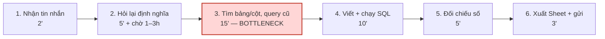

# Báo cáo cá nhân — 2A202603442_NguyenDacTuanNghia

> Template chi tiết và prompt mẫu cho từng mục: [docs/01-worksheet.md](../../docs/01-worksheet.md).

## 1. Thông tin học viên

- Họ tên: Nguyễn Đắc Tuấn Nghĩa
- MSSV: 2A202603442
- Email trường (không bắt buộc, repo có thể để public):
- Tên nhóm: 7A
- Link repo nhóm: https://github.com/ThanhBinh101/K5-L3-Day02-NguyenThiThanhBinh-2A202603497-DiscoveryProblemFraming.git

**Bối cảnh của tôi (để đọc bảng scan):** kỹ sư phần mềm mảng backend + data ở một công ty công nghệ khoảng 150 người. Team tôi có 5 dev, cùng lo 2 service backend, các pipeline dữ liệu và luân phiên trực on-call.

---

## 2. Scan problem (CP1)

Lăng kính: **Lặp lại** · **Tốn thời gian** · **Cần đọc, tổng hợp nhiều thông tin** · **Pain từ người khác**.

Tôi scan 12 problem, mỗi lăng kính 3 problem, gồm cả việc ở công ty lẫn việc học AI20k.

| # | Lăng kính | Job Story: Khi… tôi muốn… để… | Ai chịu ảnh hưởng? | Dấu hiệu thật (thời gian, tần suất, số người, bằng chứng) |
|---:|---|---|---|---|
| 1 | Lặp lại | Khi BA hoặc Sales nhắn xin số liệu (doanh thu, user active theo tỉnh/kênh) giữa giờ làm, tôi muốn trả được con số đúng định nghĩa mà không phải bỏ dở việc đang code, để họ có số làm báo cáo và tôi không bị cắt ngang nhiều lần mỗi ngày | Tôi (người trả số), 3 BA, 2 Sales lead | Đếm lại kênh `#data-request` 4 tuần gần nhất: **22 request** (~5,5/tuần); mỗi request ~**40 phút** làm thực; **13/22** cùng một mẫu "chỉ số X theo tháng, cắt theo chiều Y" |
| 2 | Lặp lại | Khi tới chiều thứ Sáu phải khai timesheet theo từng task, tôi muốn có sẵn danh sách việc mình đã làm trong tuần, để khai giờ đúng mà không phải ngồi nhớ lại từng ngày | Tôi, 4 dev trong team, HR | **15–20 phút**/tuần; HR nhắc khai trễ **2 lần** trong tháng trước (tin nhắn nhắc trong nhóm chat công ty) |
| 3 | Lặp lại | Khi nhóm lab AI20k cần hẹn buổi làm bài chung, tôi muốn chốt nhanh khung giờ cả nhóm cùng rảnh, để không mất cả buổi tối nhắn qua lại | 4 thành viên nhóm lab | **2 lần/tuần**; mỗi lần **20–30 tin nhắn** trên nhóm chat mới chốt được giờ; cả 4 người đều đi làm, lịch lệch nhau |
| 4 | Tốn thời gian | Khi được assign review một PR lớn (hơn 500 dòng, 15–25 file), tôi muốn nắm nhanh PR đổi gì và rủi ro nằm ở đâu, để review đúng chỗ mà PR của đồng đội không phải chờ quá 1 ngày làm việc | Tôi (reviewer), 4 dev là tác giả PR | **4–6 PR/tuần**, trong đó ~**2 PR lớn**, mỗi PR lớn **~45 phút**; time-to-first-review trung vị **~26 giờ** (xem timeline 20 PR gần nhất trên GitHub) |
| 5 | Tốn thời gian | Khi có sự cố production, tôi muốn lần ra service gây lỗi từ log của nhiều service, để khôi phục dịch vụ trước khi khách hàng phản ánh | Dev trực, CS, khách hàng | **2–3 sự cố/tháng**, mỗi lần **45–90 phút**, phần lớn thời gian là lọc log trên Kibana; postmortem tháng trước ghi "mất 50 phút xác định service lỗi" |
| 6 | Tốn thời gian *(ý từ AI)* | Khi cần xem lại một khái niệm coach đã giảng trong buổi học AI20k, tôi muốn tìm ra đúng đoạn trong recording dài 3–4 tiếng, để làm lab mà không phải tua lại cả buổi | Tôi, các bạn cùng lớp | **2–3 lần/tuần**, mỗi lần tua **15–25 phút**; trên kênh lớp có người hỏi "phút thứ mấy coach nói về X?" khoảng 1–2 lần/tuần |
| 7 | Cần đọc, tổng hợp nhiều thông tin | Khi nhận alert ngoài giờ trong tuần trực on-call, tôi muốn biết nhanh alert đó có ảnh hưởng người dùng thật không và cần làm gì, để không bị đánh thức vì alert nhiễu mà vẫn không bỏ sót sự cố thật | Dev trực on-call (5 người luân phiên), người dùng cuối | Tuần trực gần nhất: **12 alert**, **7/12** tự hết trong dưới 10 phút; mỗi alert ~**31 phút** xử lý; đếm từ lịch sử kênh alert |
| 8 | Cần đọc, tổng hợp nhiều thông tin | Khi nhận đề lab mới gồm nhiều file hướng dẫn, tôi muốn nắm hết yêu cầu nộp bài và các điểm trừ, để chia việc cho nhóm và không mất điểm vì sai format | Tôi, nhóm lab 3–4 người, cả lớp | **Đo trên repo đề Day02:** 16 file `.md`, ~91.600 ký tự (~18.800 từ); quy ước tên file `MSSV_HoTen` được nhắc ở **9 file** khác nhau; sai tên bị **trừ 5 điểm** (RUBRIC.md). Tôi mất ~**60–70 phút** đọc trước khi bắt tay làm |
| 9 | Cần đọc, tổng hợp nhiều thông tin *(ý từ AI)* | Khi công cụ quét dependency báo có bản vá bảo mật hoặc bản nâng cấp thư viện, tôi muốn biết bản nâng cấp có breaking change ảnh hưởng code của mình không, để quyết định nâng ngay hay hoãn | Tôi, team backend | **10–15 cảnh báo/tháng** trên 3 repo; mỗi cảnh báo đọc changelog **10–20 phút**; backlog đang tồn **~20 cảnh báo** chưa xử lý |
| 10 | Pain từ người khác | Khi có thành viên mới vào team, họ muốn tự dựng được môi trường chạy local, để nhận task ngay trong tuần đầu mà không phải chờ người hướng dẫn | Dev mới, tôi (người hay được hỏi) | Quý gần nhất có **2 người mới**; mỗi người hỏi tôi **10–15 câu** lặp lại qua chat, mất **~1,5 ngày** mới chạy được local; README setup sửa lần cuối hơn 6 tháng trước (theo git log) |
| 11 | Pain từ người khác | Khi QA và BA nhận bản release 2 tuần một lần, họ muốn biết bản này đổi gì so với bản trước, để test đúng phạm vi và báo cho khách hàng | QA (2 người), BA, tôi (người viết release note) | Mỗi release tôi mất **~40 phút** gom ticket/PR để viết release note; QA hỏi lại **3–5 câu**/release trên thread release |
| 12 | Pain từ người khác *(ý từ AI)* | Khi một bạn trong nhóm lab vắng buổi trước, bạn ấy muốn biết nhóm đã chốt những gì, để không phải hỏi lại cả nhóm và làm lệch phần đã thống nhất | Thành viên nhóm lab | ~**2 lần/tuần** có người hỏi "mình chốt gì rồi?" trên nhóm chat; mỗi lần mất **10–15 phút** của người trả lời |

---

## 3. Top 3 Problem Cards + quy trình nháp (CP2)

### Bảng chọn top 3

| Rank | Problem | Vì sao chọn | Điều còn chưa chắc |
|---:|---|---|---|
| 1 | Trả số liệu ad-hoc cho BA/Sales (#1) | Lặp lại đều, có log đếm được (22 request/4 tuần), quy trình 6 bước rõ, impact cộng dồn ~3,7 giờ/tuần. Rất hợp để so sánh 4 mức: form + dashboard (Rule) có thể giải phần lặp lại, phần còn lại mới đáng cân nhắc AI | 13/22 request "cùng mẫu" là do tôi tự phân loại, chưa ai kiểm lại. Chưa biết BA có chịu tự lấy số từ dashboard không. Quyền truy cập dữ liệu khi đưa vào công cụ ngoài |
| 2 | Xử lý alert khi trực on-call (#7) | Bottleneck rất cụ thể (bước lọc log), có số đếm từ kênh alert, ảnh hưởng tới giấc ngủ và rủi ro bỏ sót sự cố thật. Đây cũng là bài dễ kết luận "Rule là đủ", nên dùng để thử thách tư duy AI-first | Số liệu mới có 1 tuần trực. Nguyên nhân gốc có thể là ngưỡng alert, khi đó vấn đề nằm ở cấu hình chứ không ở bước xử lý |
| 3 | Review PR lớn (#4) | Có số đo khách quan trên GitHub (time-to-first-review), có chuẩn ngành để so (Google: phản hồi review tối đa 1 ngày làm việc), và đã có nhiều công cụ để research ở CP4 | Có thể nguyên nhân là PR quá to (lỗi của khâu tạo PR) chứ không phải khâu review. Chưa biết công ty có cho dùng công cụ review của bên thứ ba không |


### Problem Card #1 — Trả số liệu ad-hoc cho BA/Sales

| Trường | Nội dung |
|---|---|
| Job Story | Khi BA hoặc Sales nhắn xin số liệu (doanh thu, user active theo tỉnh/kênh) giữa giờ làm, tôi muốn trả được con số đúng định nghĩa mà không phải bỏ dở việc đang code, để họ có số làm báo cáo và tôi không bị cắt ngang nhiều lần mỗi ngày |
| Actor | **Người làm:** kỹ sư backend/data kiêm việc trả số (tôi). **Người yêu cầu:** 3 BA và 2 Sales lead, không tự viết SQL được |
| Thời điểm / bối cảnh | Giờ làm việc, rải rác cả tuần, dồn nhiều vào đầu tháng (báo cáo tháng) và thứ Năm–Sáu (chuẩn bị họp tuần). Yêu cầu đến qua tin nhắn tự do trong kênh `#data-request` |
| Quy trình hiện tại (3–7 bước) | 1. Nhận tin nhắn yêu cầu (2') → 2. Hỏi lại cho rõ: chỉ số định nghĩa thế nào, khoảng thời gian, cắt theo chiều nào (5' gõ, rồi chờ phản hồi 1–3 giờ) → 3. Tìm đúng bảng/cột trong data warehouse: đọc schema, lục query cũ, hỏi đồng nghiệp (15') → 4. Viết và chạy SQL (10') → 5. Đối chiếu với dashboard hoặc số tháng trước (5') → 6. Xuất Google Sheet, gửi kèm giải thích (3'). **Tổng ~40 phút làm thực/request** |
| Bottleneck (bước nào, mất bao nhiêu phút) | **Bước 3, tìm bảng/cột đúng: ~15 phút/request**, gần 40% thời gian làm. Lý do: không có data dictionary; cùng chỉ số "user active" có 2 cách tính ở 2 bảng khác nhau; query cũ tôi từng viết nằm rải rác trên máy và trong chat nên lần nào cũng phải tìm lại. *(Bước 2 không tốn nhiều phút làm nhưng làm lead time kéo dài; ghi nhận riêng ở metric phụ.)* |
| Impact (nếu không giải thì sao) | ~5,5 request × 40' ≈ **3,7 giờ/tuần** của tôi, chia thành nhiều lần bị cắt ngang. Lead time trung vị ~**1 ngày**, BA phải chờ để hoàn thành báo cáo. **2 lần trong 4 tuần** tôi trả số sai định nghĩa và phải gửi lại (do lấy nhầm bảng ở bước 3) |
| Success metric (baseline → target) | **Chính:** thời gian làm thực trung bình/request từ **40' → ≤ 15'**. **Phụ:** lead time trung vị từ **~1 ngày → < 4 giờ làm việc**; số lần phải gửi lại vì sai định nghĩa từ **2/4 tuần → 0**. **Cách đo:** ghi mỗi request vào một sheet log (giờ nhận, giờ gửi, số phút làm thực, có phải sửa lại không) trong 4 tuần trước và 4 tuần sau thay đổi |
| Phương án không dùng AI | (1) **Form yêu cầu** có trường bắt buộc: chọn chỉ số từ danh sách, khoảng thời gian, chiều cắt → bỏ được vòng hỏi lại ở bước 2. (2) **Data dictionary một trang** cho ~15 chỉ số hay được hỏi, ghi rõ bảng, cột, cách tính chuẩn, kèm kho query mẫu lưu trong Git → rút ngắn bước 3. (3) **Dashboard tự phục vụ** có bộ lọc tháng/tỉnh/kênh cho ~5 mẫu lặp lại nhiều nhất → BA tự lấy, không cần tôi |
| Giả thuyết về AI (nếu có) | Chỉ áp dụng cho phần request **không thuộc** mẫu có sẵn: AI soạn nháp SQL từ câu hỏi + data dictionary + query mẫu; tôi đọc, sửa, tự chạy và đối chiếu số. Boundary: AI không tự chạy query trên production, không tự gửi số cho BA. Lưu ý: text-to-SQL trên schema doanh nghiệp thật vẫn còn sai nhiều (benchmark Spider 2.0, xem mục 7), nên bước người duyệt là bắt buộc |
| Cảm nhận nhanh | **Rule** (form + data dictionary + dashboard) cho ~60% request lặp lại. Chỉ cân nhắc **Workflow** cho phần còn lại, sau khi đã có data dictionary |

Quy trình nháp hiện tại:

```text
HIỆN TẠI — ~40 phút làm thực / request, ~5,5 request / tuần (~3,7 giờ/tuần)
Lead time trung vị: ~1 ngày (phần lớn là chờ ở bước 2)

[1 Nhận tin nhắn: 2'] → [2 Hỏi lại định nghĩa: 5' + chờ 1–3h]
→ [3 Tìm bảng/cột, lục query cũ: 15'] ← BOTTLENECK (gần 40% thời gian làm)
→ [4 Viết + chạy SQL: 10'] → [5 Đối chiếu số: 5'] → [6 Xuất Sheet + gửi: 3']
```



### Problem Card #2 — Xử lý alert khi trực on-call

| Trường | Nội dung |
|---|---|
| Job Story | Khi nhận alert ngoài giờ trong tuần trực on-call, tôi muốn biết nhanh alert đó có ảnh hưởng người dùng thật không và cần làm gì, để không bị đánh thức vì alert nhiễu mà vẫn không bỏ sót sự cố thật |
| Actor | Kỹ sư backend trực on-call theo tuần (team 5 người luân phiên, mỗi người 1 tuần/5 tuần) |
| Thời điểm / bối cảnh | Ngoài giờ (19h–8h) và cuối tuần trong tuần trực. Alert từ hệ thống monitoring đẩy về nhóm chat trên điện thoại. Nhiều alert không có runbook đi kèm |
| Quy trình hiện tại (3–7 bước) | 1. Nhận alert trên điện thoại (1') → 2. Mở laptop, bật VPN, mở dashboard metric (5') → 3. Lọc log của nhiều service trên Kibana để xem lỗi có thật và có ảnh hưởng người dùng không (15') → 4. Tìm runbook trên Confluence, thường không có hoặc đã cũ (5') → 5. Quyết định: bỏ qua / tự xử lý / gọi người phụ trách (2') → 6. Ghi chú vào kênh incident (3'). **Tổng ~31 phút/alert** |
| Bottleneck (bước nào, mất bao nhiêu phút) | **Bước 3, lọc log nhiều service: ~15 phút/alert**, gần một nửa thời gian. **Nguyên nhân gốc** nằm trước quy trình: 7/12 alert là nhiễu (ngưỡng quá nhạy, chập chờn rồi tự hết), nên phần lớn 15 phút ở bước 3 là công sức bỏ phí |
| Impact (nếu không giải thì sao) | 12 alert × 31' ≈ **6,2 giờ/tuần trực**, phần lớn ngoài giờ và bị cắt ngang giấc ngủ. Khi 58% alert là nhiễu, người trực dễ quen với việc bỏ qua, và đó là lúc dễ bỏ sót sự cố thật (Google SRE gọi đây là vấn đề nhiễu tín hiệu của alert, xem mục 7) |
| Success metric (baseline → target) | **Chính:** tỉ lệ alert nhiễu mỗi tuần trực từ **58% (7/12) → < 25%**. **Phụ:** thời gian xử lý trung vị/alert từ **~30' → ≤ 10'**; không có sự cố thật nào bị phản hồi chậm quá 15 phút. **Cách đo:** xuất lịch sử kênh alert + ghi chú incident của 4 tuần trực, gắn nhãn "nhiễu / thật" cho từng alert |
| Phương án không dùng AI | (1) **Rà lại ngưỡng alert**: thêm điều kiện "kéo dài ≥ 10 phút" để chống chập chờn, gộp alert trùng. (2) **Nội dung alert kèm sẵn** link dashboard, câu truy vấn log đã lọc sẵn và runbook (Rule). (3) **Quy ước team**: alert nào không có runbook thì phải viết runbook hoặc xóa; alert nào 30 ngày không ai cần hành động thì hạ xuống mức thông báo |
| Giả thuyết về AI (nếu có) | Sau khi đã giảm nhiễu bằng Rule: khi alert đến, AI tóm tắt log + metric liên quan thành 3 dòng (có ảnh hưởng người dùng không, service nào, bước runbook gợi ý). Người trực vẫn tự quyết định; AI không được tự restart service hay tắt alert |
| Cảm nhận nhanh | **Rule** (chỉnh ngưỡng + gắn link sẵn vào alert). AI chỉ đáng thử nếu sau khi giảm nhiễu, bước 3 vẫn tốn trên 10 phút |

Quy trình nháp hiện tại:

```text
HIỆN TẠI — ~31 phút / alert, 12 alert / tuần trực (~6,2 giờ, phần lớn ngoài giờ)
Gốc rễ: 7/12 alert là nhiễu → bước 3 thường lặp lại vô ích

[1 Nhận alert trên điện thoại: 1'] → [2 Mở laptop, VPN, dashboard: 5']
→ [3 Lọc log nhiều service trên Kibana: 15'] ← BOTTLENECK
→ [4 Tìm runbook (thường không có): 5'] → [5 Quyết định: 2'] → [6 Ghi chú incident: 3']
```

### Problem Card #3 — Review PR lớn

| Trường | Nội dung |
|---|---|
| Job Story | Khi được assign review một PR lớn (hơn 500 dòng, 15–25 file), tôi muốn nắm nhanh PR đổi gì và rủi ro nằm ở đâu, để review đúng chỗ mà PR của đồng đội không phải chờ quá 1 ngày làm việc |
| Actor | **Reviewer:** tôi, reviewer chính của 2 service. **Tác giả PR:** 4 dev còn lại trong team. Quy định team: cần 1 approve mới được merge |
| Thời điểm / bối cảnh | Trong giờ làm, PR đến bất kỳ lúc nào trong khi tôi đang làm task của mình. PR lớn thường dồn vào cuối sprint |
| Quy trình hiện tại (3–7 bước) | 1. Nhận thông báo review (1'; nhưng thường để vài giờ mới mở vì đang dở việc) → 2. Đọc mô tả PR + ticket liên quan (5') → 3. Đọc diff và mở code xung quanh để dựng lại ngữ cảnh (20') → 4. Chạy thử local / xem kết quả CI (5') → 5. Viết comment (7') → 6. Review lại sau khi tác giả sửa (7'). **Tổng ~45 phút/PR lớn** |
| Bottleneck (bước nào, mất bao nhiêu phút) | **Bước 3, dựng lại ngữ cảnh từ diff: ~20 phút/PR lớn**, gần một nửa thời gian. Mô tả PR thường chỉ có 1 dòng nên bước 2 không giúp được bao nhiêu; tôi phải tự đoán thứ tự đọc 15–25 file |
| Impact (nếu không giải thì sao) | Review ~**2,25 giờ/tuần** (2 PR lớn × 45' + ~3 PR nhỏ × 15'). Time-to-first-review trung vị **~26 giờ**, vượt chuẩn "tối đa 1 ngày làm việc" của Google eng-practices; tác giả bị block, dễ conflict khi merge. Với PR lớn, tôi dễ review vội, đọc lướt các file cuối |
| Success metric (baseline → target) | **Chính:** thời gian bước 2 + 3 cho PR lớn từ **~25' → ≤ 10'**. **Phụ:** time-to-first-review trung vị từ **~26 giờ → < 8 giờ làm việc**; tỉ lệ PR lớn hơn 400 dòng từ ~**40% → < 15%**. **Cách đo:** timeline PR trên GitHub (thời điểm request review → review đầu tiên, số dòng thay đổi) trong 3 tuần + tự ghi số phút cho bước 2–3 |
| Phương án không dùng AI | (1) **Quy ước PR nhỏ** (≤ 400 dòng), tách theo bước, đúng tinh thần "Small CLs" của Google. (2) **PR template bắt buộc**: đổi gì, vì sao, chỗ cần review kỹ, cách test → biến bước 3 thành việc đọc có định hướng. (3) **2 khung giờ review cố định/ngày** + phân reviewer theo vùng code (CODEOWNERS) |
| Giả thuyết về AI (nếu có) | AI tạo "bản đồ đọc" cho PR lớn: tóm tắt theo file, đề xuất thứ tự đọc, đánh dấu chỗ rủi ro (đổi schema, xử lý lỗi, bảo mật). Reviewer vẫn đọc code và tự approve; AI không được approve hay merge. Đã có công cụ sẵn (ví dụ GitHub Copilot code review), cần research ở CP4 thay vì tự xây |
| Cảm nhận nhanh | **No AI** (PR nhỏ + template) trước. Nếu PR lớn vẫn còn nhiều thì dùng **Workflow** với công cụ có sẵn |

Quy trình nháp hiện tại:

```text
HIỆN TẠI — ~45 phút / PR lớn, ~2 PR lớn + ~3 PR nhỏ / tuần (~2,25 giờ/tuần)
Time-to-first-review trung vị: ~26 giờ

[1 Nhận thông báo (chờ vài giờ mới mở): 1'] → [2 Đọc mô tả + ticket: 5']
→ [3 Đọc diff, dựng lại ngữ cảnh 15–25 file: 20'] ← BOTTLENECK
→ [4 Chạy local / xem CI: 5'] → [5 Viết comment: 7'] → [6 Review lại: 7']
```

### Card muốn pitch nhất

- Card số: **1** (Trả số liệu ad-hoc cho BA/Sales).
- Vì sao: Đây là card có bằng chứng tốt nhất (đếm được từ log kênh chat, 22 request/4 tuần), impact cộng dồn lớn nhất (~3,7 giờ/tuần), và có người ngoài tôi chịu ảnh hưởng (BA phải chờ ~1 ngày). Card này cũng buộc nhóm phải so sánh thật sự cả 4 mức: rất có thể form + dashboard (Rule) giải được phần lớn, và AI chỉ còn ý nghĩa với phần "request lạ". Nhóm dễ kiểm chứng ở CP4 vì trong lớp có nhiều bạn làm data/BA.
- Câu hỏi muốn nhóm phản biện: **"Nếu 13/22 request đúng là lặp lại theo mẫu thì dashboard tự phục vụ + form chuẩn hóa đã đủ chưa? Hay chính 9 request 'lạ' còn lại mới là chỗ tốn thời gian thật, và mình đang đo sai bottleneck?"**

### AI đã phản biện card thế nào

Tôi dán từng card vào AI (Claude) với prompt "PM hoài nghi" trong worksheet (6 câu: actor, quy trình có thật không, bottleneck, metric, rule đã đủ chưa, có nhảy sang AI quá sớm không; chỉ nói điểm yếu).

| Điểm yếu AI chỉ ra | Đồng ý? | Đã sửa gì |
|---|---|---|
| **Card 1:** "Lead time 1 ngày chủ yếu do chờ BA trả lời ở bước 2, không phải do tìm bảng. Bạn đang gộp 2 loại 'chậm' làm một" | Đồng ý | Tách 2 metric: **thời gian làm thực** (bottleneck bước 3) và **lead time** (nghẽn ở bước 2). Thêm "form yêu cầu có trường bắt buộc" vào phương án không dùng AI để xử lý riêng bước 2 |
| **Card 1:** "'22 request' đếm từ đâu? Có phân biệt request mới với request lặp lại không? Nếu không phân loại thì không biết Rule giải được bao nhiêu" | Đồng ý | Đọc lại kênh và phân loại 22 request: 13/22 cùng mẫu. Ghi rõ đây là tôi tự phân loại, đưa vào cột "điều còn chưa chắc" để nhóm kiểm ở CP4 |
| **Card 1:** "Bạn đang nhảy sang text-to-SQL quá sớm. Nếu 60% là lặp lại thì dashboard đã đủ cho phần đó" | Đồng ý | Đổi cảm nhận nhanh từ **Workflow** thành **Rule trước, Workflow chỉ cho phần còn lại**. Thêm ghi chú về độ chính xác text-to-SQL trên schema thật (Spider 2.0) và boundary "AI không tự chạy query, không tự gửi số" |
| **Card 1:** "Metric chỉ đo tốc độ. Trả số nhanh hơn nhưng sai thì sao?" | Đồng ý | Thêm metric phụ: **số lần phải gửi lại vì sai định nghĩa** (baseline 2/4 tuần → target 0) |
| **Card 2:** "Bottleneck thật nằm ở cấu hình ngưỡng (7/12 là nhiễu), không phải bước đọc log. Tối ưu bước 3 là tối ưu sai chỗ" | Đồng ý một phần | Giữ bước 3 là bottleneck **trong quy trình xử lý** (vì vẫn tốn 15 phút với alert thật), nhưng ghi rõ **nguyên nhân gốc** là nhiễu và đổi metric chính sang **tỉ lệ alert nhiễu**. Cảm nhận nhanh chốt **Rule** |
| **Card 2:** "Số liệu chỉ từ 1 tuần trực, chưa đủ để kết luận 58% nhiễu" | Đồng ý | Cách đo đổi sang xuất lịch sử kênh alert của **4 tuần trực** gần nhất và gắn nhãn từng alert. Ghi vào "điều còn chưa chắc" |
| **Card 3:** "PR lớn là nguyên nhân. Chia PR nhỏ và viết mô tả tốt (No AI) có thể giải gần hết. Metric 'review tốt hơn' cũng khó đo" | Đồng ý | Thêm phương án **PR ≤ 400 dòng + PR template + 2 khung review cố định**; đổi metric sang các số đo được trên GitHub: **time-to-first-review** và **tỉ lệ PR lớn hơn 400 dòng**; cảm nhận nhanh đổi thành **No AI trước** |
| **Card 3:** AI gợi ý "dùng agent tự sửa code theo comment review rồi tự merge cho nhanh" | **Không đồng ý** | Đây là tự động hóa quá mức, bỏ mất bước kiểm soát chất lượng mà review sinh ra để làm. Giữ boundary **AI không approve, không merge**; theo tài liệu GitHub, review của Copilot mặc định cũng không được tính là approve bắt buộc |

---

## 4. Tôi đã tham gia phần nào (CP3 → CP7)

| Hoạt động | Tôi đã làm gì? | Kết quả / ảnh hưởng tới bài nhóm |
|---|---|---|
| Pitch Problem Card | Chủ động rút card của mình (mục 3) để nhóm tập trung thời gian thảo luận sâu hơn vào các Problem Card khả thi của Nhật và Bình. | Giúp nhóm tiết kiệm thời gian hội tụ và tập trung mổ xẻ được chi tiết bottleneck của bài toán đối chiếu máy phòng lab. |
| Phản biện bài của bạn khác | Tôi đã đặt câu hỏi cho candidate #10 của Đặng Long Nhật: "28 phút/ca và 12 phút đối chiếu là số đo ở lab thật hay số mô phỏng? Nếu chỉ dùng bảng tính theo mã máy thì đã đủ chưa, hay cần AI?" | Câu hỏi được ghi nhận vào bảng pitch (mục 2.1), giúp nhóm định hình lại việc không nên lạm dụng AI (Agent) mà hướng về mức Rule/bảng tính. |
| Nhận phản biện | Áp dụng sửa 7 điểm theo phản biện của AI ở CP2 cho bài cá nhân (không theo gợi ý merge). | Hoàn thiện kỹ năng viết problem statement dù bài không được chọn đi tiếp. |
| Gom cluster / cây OST | Tham gia thảo luận và hỗ trợ nháp Opportunity C trong cây OST: "Người dùng cần ghép đúng thông tin giữa các nguồn để hoàn tất quy trình..." | Định hình được cluster C (mục 2.2). Cùng nhóm gạch bỏ các ý tưởng "solution đội lốt opportunity" (như dùng chatbot/LLM). |
| Chọn candidate problem | Tham gia thảo luận và chấm điểm shortlist (mục 2.4). Tôi đã phân tích để thống nhất cho candidate "Đối chiếu tình trạng 12 máy" điểm 5/5 ở tiêu chí Vừa sức lab và Quy trình rõ. | Giúp candidate của Nhật đạt tổng điểm cao nhất (27 điểm) và được chọn làm bài toán trọng tâm của nhóm. |
| Kiểm chứng / research | Tìm kiếm tài liệu và đối chiếu công cụ Snipe-IT và tính năng Sắp xếp/Lọc của Google Sheets (mục 3.3). Cùng nháp Assumption Map (giả định #4). | Đưa ra được bảng so sánh điểm mạnh/rủi ro thực tế của giải pháp, củng cố phương án dùng mã máy cố định. |
| Quy trình nhóm | Phác thảo sơ đồ luồng quy trình hiện tại (5 bước) và quy trình tương lai (rút gọn bước đối chiếu bằng Rule) (mục 4.1 & 4.2). | Hình thành sơ đồ Mermaid chuẩn xác trong báo cáo nhóm, làm rõ được Bottleneck nằm ở bước 3 (12 phút/ca). |
| Problem Statement | Trực tiếp tham gia viết phần Impact và Success Metric cho bản v0 và v1, đề xuất con số target trung bình ≤ 20 phút/ca. | Giúp làm rõ ranh giới (Boundary) và đưa ra cách đo lường cụ thể cho 5 ca thật trước/sau khi thử nghiệm (mục 5 & 7). |
| Mức can thiệp AI | Phân tích ma trận và bảo vệ quan điểm chọn mức Rule thay vì Workflow hay Agent (mục 6.2). | Nhóm thống nhất chốt mức Rule, dùng dữ liệu có cấu trúc để lọc theo mã máy, tránh over-engineering không cần thiết. |
| Quyết định | Đánh giá 4 rủi ro, trong đó tôi chỉ ra rủi ro Value đang ở mức Cao vì số liệu hoàn toàn là mô phỏng. Cùng nhóm thảo luận đưa ra "Ngưỡng dừng". | Nhóm chốt quyết định Not Yet (mục 8.2), ưu tiên việc phải đi đo baseline 5 ca thật trước khi làm pilot. |


---

## 5. Dùng AI

| Checkpoint | Tôi dùng AI để làm gì? | AI hữu ích ở đâu? | AI sai hoặc hời hợt ở đâu? | Tôi sửa gì bằng nhận định của mình? |
|---|---|---|---|---|
| CP1 Scan | Mô tả công việc hằng tuần của tôi rồi nhờ AI gợi ý thêm problem theo 4 lăng kính và viết lại thành Job Story | Gợi ý được 3 ý tôi không nghĩ tới (#6, #9, #12); giúp chia đều problem cho 4 lăng kính | Đưa 4 ý không dùng được: 1 solution trá hình ("trợ lý trả lời câu hỏi số liệu"), 1 ý trùng bài mẫu, 1 ý không có số đo, 1 ý quá rộng | Bỏ 4 ý đó (lý do ở mục 2); viết lại các ý giữ lại theo trải nghiệm thật và gắn dấu hiệu của chính tôi |
| CP2 Problem Card | Đóng vai PM hoài nghi phản biện 3 card | Chỉ ra tôi gộp "chậm do chờ" với "chậm do làm" ở card 1; chỉ ra nguyên nhân gốc ở card 2 là ngưỡng alert | Có lúc lại đề xuất ngược hướng: gợi ý agent tự sửa code và tự merge ở card 3 | Sửa 7 điểm (bảng ở mục 3); không theo gợi ý agent, giữ boundary AI không approve/merge |
| CP4 Research | | | | |
| CP5 Quy trình | | | | |
| CP5–6 Problem Statement | | | | |
| CP6 Mức can thiệp / quyết định | | | | |

---

## 6. Reflection (CP7)

Trả lời bằng trải nghiệm thật của bạn, tối thiểu 200 từ cho các câu 6.1–6.6 (không tính 6.7, câu này được chấm riêng ở tiêu chí C5). **Không dùng AI để viết thay.**

**6.1. Tôi học được gì khi nghe top 3 problems của các bạn khác?**
Khi lắng nghe các candidate problem từ các bạn (như bài chẩn đoán lỗi xe VinFast của Tú hay kế hoạch VinWonders của Bình), bài học lớn nhất tôi rút ra được là tính xác minh của dữ liệu Baseline và phạm vi đo lường. Nhiều bài toán nghe rất hấp dẫn và có bối cảnh thực tế lớn, nhưng khi soi kỹ lại thiếu số liệu đo thời gian/tần suất cụ thể (chỉ dựa vào lời kể của 1–2 người) hoặc có phạm vi quá rộng, phụ thuộc nhiều yếu tố bên ngoài nên khó thu hẹp thành một thử nghiệm gọn trong lab. Một bài toán tốt không nhất thiết phải hoành tráng, mà cần có actor rõ ràng, bottleneck đo đếm được bằng con số và có thể kiểm chứng độc lập.

**6.2. Nhóm có lúc nào bị "solution-first" (nghĩ giải pháp trước khi hiểu vấn đề) không? Lúc đó nhóm nhận ra và xử lý thế nào?**
Nhóm đã vướng bẫy "solution-first" ngay ở CP3 khi xây dựng cây Opportunity Solution Tree (OST). Ban đầu, các thành viên liên tục đưa ra các đề xuất như "Làm chatbot LLM tự đọc sổ bàn giao", "Tự động chẩn đoán lỗi xe VinFast" hay "Dựng app/dashboard tự tối ưu tuyến đi".

**6.3. Tôi có đổi ý sau khi bị phản biện không? Kể một lần cụ thể.**
Tôi đã đổi ý ở bước chọn mức độ can thiệp AI ở CP6. Ban đầu, tôi nghiêng về phương án dùng Workflow hoặc Agent kết hợp LLM để xử lý các đoạn ghi chú bàn giao dạng văn bản tự do do người giao ca viết.

**6.4. Kết quả kiểm chứng (phỏng vấn/survey/research) có làm tôi bất ngờ không? Điều gì?**
Điều làm tôi bất ngờ nhất là khi rà soát lại hồ sơ nguồn ở CP4 và phát hiện toàn bộ mốc 28 phút/ca và 12 phút ở bước đối chiếu hoàn toàn là số liệu mô phỏng, chưa hề có một ca đo thực địa hay cuộc phỏng vấn thực tế nào được ghi nhận.

**6.5. Điều khó nhất khi viết Problem Statement là gì?**
Điều khó nhất là xác định Boundary (Ranh giới can thiệp) và đóng khung Success Metric đủ chặt chẽ. Rất dễ sa vào bẫy đặt target chung chung như "giúp tiết kiệm thời gian", nhưng viết Problem Statement chuẩn đòi hỏi phải chốt mốc thời gian cụ thể (rút từ 28 phút xuống ≤ 20 phút/ca) đi kèm chỉ tiêu chất lượng nghiêm ngặt (0 máy bị gắn sai trạng thái "Dùng được").

**6.6. Nếu làm lại, tôi sẽ đổi gì? Tôi sẽ phản biện nhóm mạnh hơn ở điểm nào?**
Nếu được làm lại, tôi sẽ yêu cầu nhóm phải đi đo baseline thực tế ở 5 ca trực lab ngay từ CP4 chứ không chấp nhận dùng số liệu mô phỏng để chấm điểm shortlist.

**6.7. Hiểu bài:** giải thích bằng 5–8 câu, không nhìn tài liệu, chuỗi *problem → quy trình → metric → boundary → mức can thiệp AI → quyết định* của bài nhóm mình. 
Bài toán giải quyết việc sinh viên trực lab mất thời gian đối chiếu ghi chú bàn giao lỗi với 12 máy trước giờ học. Quy trình 5 bước được giữ nguyên, riêng bước 3 được hỗ trợ bằng bộ lọc tự động ghép lỗi theo mã máy. Success Metric hướng tới giảm thời gian ca từ 28 phút (mô phỏng) xuống ≤ 20 phút/ca và đạt 0 máy báo sai "Dùng được". Ranh giới (Boundary) xác định hệ thống chỉ hỗ trợ hiển thị dữ liệu, người trực lab là bên duy nhất kiểm tra và chốt danh sách gửi giảng viên. Mức can thiệp chọn Rule với các điều kiện lọc cố định để tối ưu chi phí và tránh rủi ro từ AI. Quyết định cuối cùng là Not Yet pilot trên ca thật vì rủi ro Value còn ở mức Cao do thiếu dữ liệu thực địa. Nhóm ưu tiên đo baseline 5 ca thật liên tiếp để kiểm chứng bottleneck thực tế trước khi triển khai công cụ.

---

