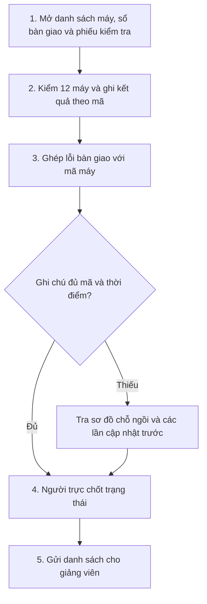
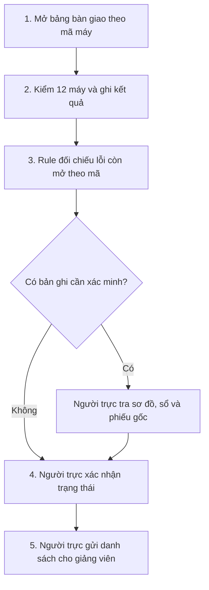

# Báo cáo nhóm — Day 02 Discovery & Problem Framing

> Bản chung của nhóm, viết trên repo do nhóm trưởng fork. Không copy file này sang repo cá nhân.
> Template chi tiết và prompt mẫu: [docs/01-worksheet.md](../../docs/01-worksheet.md). Bài mẫu: [docs/02-deliverable-example.md](../../docs/02-deliverable-example.md).

## 1. Thông tin nhóm

- Tên nhóm: 7A
- Thành viên: xem `TEAM.md`
- Candidate problem được chọn (1 câu):
- Quyết định cuối: Go / Not Yet / No-Go

---

## 2. Hội tụ nhóm (CP3)

### 2.1. Pitch

|   # | Người đưa ra          | Candidate (Job Story ngắn)                                                                                                                 | Actor                                                          | Bottleneck                                                                                                                   | Câu hỏi phản biện nhận được (ai hỏi)                             |
| --: | --------------------- | ------------------------------------------------------------------------------------------------------------------------------------------ | -------------------------------------------------------------- | ---------------------------------------------------------------------------------------------------------------------------- | ---------------------------------------------------------------- |
|   1 | Nguyễn Anh Tú         | Khi xe VinFast báo lỗi, tôi muốn biết cần xử lý gấp hay có thể đợi để quyết định có đi xưởng ngay không.                                   | Chủ xe VinFast                                                 | 1–3 ngày từ lúc thấy lỗi đến khi có đánh giá/ra quyết định (lời kể; chưa tách thời gian chờ xưởng).                          | Câu hỏi — Hoàng Minh Huy (đã hỏi): Nếu mô tả triệu chứng chưa đủ để đánh giá nguy hiểm, làm sao tránh đánh giá thấp lỗi khiến chủ xe tiếp tục lái xe không an toàn; khi không chắc, có nên hướng người dùng đến kỹ thuật viên/cứu hộ?|
|   2 | Nguyễn Anh Tú         | Khi căn hộ Vinhomes có sự cố, tôi muốn biết phản ánh đã đến đúng bộ phận và khi nào được xử lý để không phải gọi lại nhiều lần.            | Cư dân, ban quản lý                                            | Trên 3 ngày theo lời kể của một người quen; nguồn công khai nêu SLA tùy mức độ, cần xác định loại sự cố và trạng thái phiếu. | “Lần gần nhất theo người quen là sự cố gì, 3 ngày tính đến lúc được tiếp nhận hay xử lý xong, và cư dân đã phải liên hệ lại bao nhiêu lần?” (Thanh Bình) |
|   3 | Nguyễn Anh Tú         | Khi gọi Xanh SM ở điểm đón đông, tôi muốn gặp tài xế nhanh để không phải gọi/nhắn chỉ vị trí.                                              | Hành khách, tài xế                                             | Ước lượng 5–10 phút từ lúc gọi đến lúc gặp xe; chưa đo.                                                                      | Dùng tiêu chí nào để xác định một điểm đón là đông? Khó khăn này thường xảy ra ở đâu và vào khung giờ nào?(Đặng Long Nhật) |
|   4 | Hoàng Minh Huy        | Khi cần hỗ trợ sản phẩm/dịch vụ, tôi muốn nhận câu trả lời chính xác mà không phải chờ lâu hay nhắc lại thông tin.                         | Khách hàng, nhân viên hỗ trợ                                   | Chưa có số baseline; cần quan sát thời gian chờ và số lượt bổ sung/liên hệ lại cho một loại yêu cầu cụ thể.                  | “Bạn đang nói đến loại yêu cầu và kênh hỗ trợ nào; dựa vào đâu xác định yêu cầu được giải quyết ngay lần đầu thay vì phải bổ sung/chuyển tiếp?” (Thanh Bình)|
|   5 | Hoàng Minh Huy        | Khi tìm sản phẩm trong cửa hàng trực tuyến, tôi muốn tìm lựa chọn phù hợp mà không phải lọc quá nhiều kết quả.                             | Người mua sắm trực tuyến                                       | Chưa đo; cần bấm giờ tác vụ và đếm số lần đổi truy vấn/bộ lọc.                                                               | Nếu số lần lọc giảm nhưng tỷ lệ người mua tìm được sản phẩm đáp ứng tiêu chí cũng giảm, thì sẽ đánh giá kết quả thế nào?(Đặng Long Nhật) |
|   6 | Hoàng Minh Huy        | Khi học ngoại ngữ trực tuyến và bị chậm tiến độ, tôi muốn biết nên tiếp tục từ đâu để duy trì việc học.                                    | Người học ngoại ngữ trực tuyến                                 | Chưa đo; cần hỏi về lần gần nhất bỏ lỡ lịch và thời gian quay lại học.                                                       | Câu hỏi — Nguyễn Anh Tú (đã hỏi): Lần gần nhất bạn bỏ lỡ buổi học online là khi nào, mất bao lâu mới quay lại, và lý do là không biết học tiếp từ đâu hay là hết động lực? Nếu chỉ đánh dấu bài tiếp theo thủ công thì đã đủ chưa, hay thật sự cần AI?|
|   7 | Nguyễn Thị Thanh Bình | Khi kế hoạch đã lập cần đổi vì tình trạng trò chơi/hàng chờ, tôi muốn cập nhật lựa chọn và xem thông tin liên quan thuận tiện để không lỡ show ưu tiên. | Phụ huynh điều phối chuyến đi cho gia đình có trẻ nhỏ | App đã có lập kế hoạch; lần kiểm tra ghi nhận chưa thấy tự điều chỉnh theo tình trạng/chờ thực tế và phải chuyển nhiều mục để xem thông tin liên quan; thời lượng chưa đo. | Tính «đến kịp show» theo giờ bắt đầu hay theo giờ gia đình cần có mặt để vào xem? (Đặng Long Nhật) |
|   8 | Nguyễn Thị Thanh Bình | Khi cần nhà vệ sinh hoặc mua nước, tôi muốn tìm điểm phù hợp, thuận đường và biết khả năng tiếp cận/trạng thái đông.                       | Người lớn chăm sóc trẻ nhỏ hoặc hỗ trợ người hạn chế di chuyển | Giả định: tìm/chọn khoảng 3 phút; scan nêu chờ nhà vệ sinh 15–30 phút nhưng chưa xác minh.                                   | Câu hỏi — Hoàng Minh Huy (đã hỏi): WC và điểm mua nước có cùng người dùng/bối cảnh hay nên tách thành hai vấn đề? Nguồn nào xác nhận điểm đang mở, đường đi và khả năng tiếp cận đủ chính xác?|
|   9 | Nguyễn Thị Thanh Bình | Khi cần ăn trong ngày tham quan, tôi muốn xem menu và chọn nơi phù hợp ngân sách, lịch trình, số lượng người và nhu cầu gia đình.          | Người lớn chọn bữa ăn cho gia đình có trẻ nhỏ/người lớn tuổi   | Giả định: so sánh 3 nhà hàng khoảng 6 phút; thời gian chờ order 30 phút cần xác minh riêng.                                  | Câu hỏi — Nguyễn Anh Tú (đã hỏi): Lần gần nhất bạn chọn chỗ ăn cho gia đình là khi nào, thật sự mất bao lâu, và khó nhất là tìm menu hay đoán thời gian chờ? Nếu chỉ có danh sách và bộ lọc thì đã đủ chưa, hay cần AI?|
|  10 | Đặng Long Nhật        | Khi kiểm tra máy trước ca lab, tôi muốn đối chiếu kết quả kiểm tra và lỗi bàn giao theo mã máy để báo máy dùng được/cần đổi trước giờ học. | Sinh viên CNTT trực phòng lab, giảng viên, sinh viên           | Bộ số liệu mô phỏng: 12 phút đối chiếu; tổng 28 phút/ca, 4/5 ca vượt mốc 25 phút. Không phải số đo thực tế.                  | Câu hỏi — Nguyễn Anh Tú (đã hỏi): 28 phút/ca và 12 phút đối chiếu là số đo ở lab thật hay số mô phỏng? Nếu chỉ dùng bảng tính theo mã máy thì đã đủ chưa, hay cần AI? |
|  11 | Đặng Long Nhật        | Khi máy báo lỗi thiếu thư viện giữa ca, tôi muốn xác định đúng môi trường Python để khôi phục bài đang làm.                                | Người trực phòng lab, sinh viên gặp lỗi                        | Bộ số liệu mô phỏng: trung bình 14 phút/lượt xử lý; cần kiểm chứng bằng ca thực.                                             | CCâu hỏi — Hoàng Minh Huy (đã hỏi): Có thể xử lý bằng hướng dẫn chuẩn hoặc quy tắc kiểm tra môi trường trước khi dùng AI không? Làm sao xác nhận lỗi đã xử lý mà không làm hỏng môi trường hay gián đoạn bài đang chạy?|
|  12 | Đặng Long Nhật        | Khi nộp bài trên máy phòng lab, tôi muốn nhận ra đúng thư mục nộp để lưu bài ngay lần đầu.                                                 | Sinh viên nộp bài, giảng viên chấm                             | Bộ số liệu mô phỏng: trung bình 8 phút/lượt mở nhầm; cần kiểm chứng bằng tác vụ thực.                                        | “Nguyên nhân mở nhầm là tên thư mục hay hướng dẫn, và đổi tên/hướng dẫn có giải quyết được mà không cần AI không?” (Thanh Bình) |

### 2.2. Cluster

| Cluster                                         | Các candidate                      | Pattern chung                                                                                                                                          |
| ----------------------------------------------- | ---------------------------------- | ------------------------------------------------------------------------------------------------------------------------------------------------------ |
| A — Tìm/chọn phương án phù hợp                  | Tú #2; Huy #2; Bình #1, #3         | Người dùng phải so sánh nhiều lựa chọn theo tiêu chí và lịch trình; dữ liệu, baseline và mức độ thường xuyên còn cần kiểm chứng.                       |
| B — Biết trạng thái và bước xử lý tiếp theo     | Tú #1, #2, #3; Huy #1; Bình #1, #2 | Người dùng chưa rõ tình trạng, mức chờ/khẩn cấp hoặc nơi cần liên hệ; cần phân biệt thời gian chờ thực tế với thời gian tìm/ra quyết định.             |
| C — Đối chiếu thông tin trong quy trình lặp lại | Nhật #1, #2, #3                    | Người dùng phải kiểm tra/ghép thông tin để hoàn tất công việc đúng hạn; số liệu trong bài Nhật được ghi rõ là mô phỏng, chưa phải bằng chứng thực địa. |

### 2.3. Opportunity Solution Tree rút gọn

Gốc là **1 outcome**. Nhánh là **opportunity** (nhu cầu, pain), không phải tính năng hay công cụ.

```text
OUTCOME (bản nháp để thảo luận, chưa được nhóm xác nhận):
Người dùng xác định được bước tiếp theo phù hợp mà không phải dò tìm hoặc đối chiếu thông tin lặp lại.
├── Opportunity A: Người dùng cần biết tình trạng hiện tại và mức độ cần xử lý của vấn đề/yêu cầu.
├── Opportunity B: Người dùng cần tìm và so sánh lựa chọn theo tiêu chí, bối cảnh và thời gian có hạn.
└── Opportunity C: Người dùng cần ghép đúng thông tin giữa các nguồn để hoàn tất một quy trình đúng hạn.
```

Những ý đã gạch bỏ vì là solution đội lốt opportunity:

- “Dùng chatbot/LLM/Agent” — công nghệ, chưa phải nhu cầu.
- “Tự động chẩn đoán xe / tự phân loại và chuyển phiếu / tự tối ưu tuyến / cá nhân hóa kết quả tìm kiếm” — các phương án giải quyết; cần xác nhận problem và boundary trước.
- “Làm dashboard/app mới” — hình thức sản phẩm, chưa nêu outcome người dùng.

### 2.4. Chấm điểm shortlist (1–5)

| Candidate                                                                                                                       | Actor rõ | Quy trình rõ | Pain có bằng chứng | Impact đo được | Vừa sức lab | So sánh được No AI/Rule/Workflow/Agent | Nhóm hiểu domain | Tổng |
| ------------------------------------------------------------------------------------------------------------------------------- | -------: | -----------: | -----------------: | -------------: | ----------: | -------------------------------------: | ---------------: | ---: |
| Đối chiếu tình trạng 12 máy trước ca lab (Nhật #1; số liệu mô phỏng)                                                            |        5 |            5 |                  1 |              3 |           5 |                                      4 |                4 |   27 |
| Xe VinFast báo lỗi: xác định cần xử lý gấp hay có thể đợi (Tú #1; lời kể người nhà, chưa xác minh loại lỗi/thời gian từng bước) |        4 |            4 |                  2 |              3 |           2 |                                      4 |                2 |   21 |
| Cập nhật kế hoạch VinWonders đã lập theo tình trạng/chờ thực tế, giảm chuyển mục (Bình #1; actor giả định là phụ huynh điều phối gia đình có trẻ nhỏ) |        5 |            5 |                  1 |              3 |           4 |                                      4 |                4 |   26 |
| Tiếp nhận và giải quyết yêu cầu hỗ trợ ngay lần liên hệ đầu (Huy #1; chưa có baseline)                                          |        4 |            4 |                  1 |              2 |           4 |                                      4 |                2 |   21 |

**Giải thích hai tiêu chí còn lại cho Bình #1:**

- **Nhóm hiểu domain — 4/5:** Bình đã kiểm tra app và xác nhận app có lập kế hoạch phù hợp; ghi nhận khoảng trống theo lần kiểm tra: chưa thấy kế hoạch tự điều chỉnh theo tình trạng/thời gian chờ thực tế, chưa tìm thấy chỗ xem WC/menu thuận tiện trong cùng luồng, và phải chuyển qua nhiều mục. Chưa có phỏng vấn khách/nhân viên hoặc xác nhận nguồn, độ cập nhật dữ liệu; cần task walkthrough và kiểm tra theo phiên bản/địa điểm trước khi chấm cao hơn.
- **Vừa sức lab — 4/5:** Có thể làm prototype hẹp cho một lượt chọn trò, nhưng bài toán đầy đủ còn phụ thuộc dữ liệu hàng chờ, lịch show, điều kiện tham gia và đường đi; tích hợp dữ liệu trực tiếp chưa được xác nhận. Để có cơ sở chấm 5, nhóm cần chốt phạm vi lab thành prototype cho một tình huống (chọn trò tiếp theo trước một show đã ưu tiên), dùng danh sách trò và dữ liệu mẫu có nhãn giả định, không tích hợp realtime hay triển khai tại công viên; đánh giá bằng một tác vụ thử có tiêu chí rõ.

_Các điểm hiện tại giữ nguyên đến khi nhóm xác nhận phạm vi prototype và có bằng chứng domain; đề xuất phạm vi trên chưa được xem là quyết định chính thức của nhóm._

**Candidate được chọn:** Chưa có bằng chứng về quyết định/biểu quyết nhóm trong các báo cáo cá nhân; cần ghi candidate nhóm thống nhất sau khi thảo luận.

**Vì sao chọn:** Chưa chốt. Điểm sơ bộ cao nhất hiện là bài toán đối chiếu tình trạng máy trước ca, nhưng số liệu hoàn toàn là mô phỏng; không nên xem đây là lựa chọn cuối nếu nhóm chưa xác nhận bối cảnh hoặc thu thập bằng chứng thực.

**Vì sao loại các candidate còn lại:** Chưa có quyết định loại chính thức. Các ứng viên còn lại chưa được chấm đồng bộ; cần ghi lý do sau khi nhóm so sánh và biểu quyết.

**Xử lý bất đồng (nếu có):** Chưa ghi nhận bất đồng hoặc cách xử lý trong tài liệu cá nhân; cập nhật theo diễn biến thật của buổi thảo luận.

---

## 3. Kiểm chứng + research giải pháp đã có (CP4)

**Candidate** — Đối chiếu tình trạng 12 máy trước ca lab (Nhật #1, số liệu mô phỏng). Người trực phòng thực hành cần ghép kết quả đăng nhập thử và bài kiểm tra Python ngoại tuyến của ca hiện tại với lỗi bàn giao theo mã máy để báo cho giảng viên máy nào **Dùng được**, máy nào **Cần đổi chỗ**. [Problem Card #1 của Đặng Long Nhật](../individual/2A202603483_DangLongNhat.md)

### 3.1. Assumption Map

**Đề xuất — chờ nhóm xác nhận.** Điểm quan trọng phản ánh ảnh hưởng nếu giả định sai. Điểm bằng chứng 1/5 nghĩa là nhóm chưa có dữ liệu thực địa để đánh giá giả định.

| # | Giả định | Loại (Value / Usability / Feasibility / Viability) | Quan trọng (1–5) | Đã có bằng chứng (1–5) | Kiểm chứng trước? |
|---:|---|---|---:|---:|---|
| 1 | Tra lại mã máy và thời điểm cập nhật lỗi là nguyên nhân chính khiến bước đối chiếu tốn thời gian trong ca thật. | Value | 5 | 1 | Có. Bấm giờ từng bước và ghi số lượt tra lại theo từng nguyên nhân. |
| 2 | Khi danh sách trạng thái đến sau giờ bắt đầu, giảng viên phải sắp xếp đổi chỗ trong lúc lớp đã vào ca. | Value | 4 | 1 | Có. Đối chiếu giờ gửi với giờ bắt đầu và ghi nhận các lần phải đổi chỗ. |
| 3 | Người giao ca và người nhận ca có thể ghi và tra mã máy, thời điểm, trạng thái lỗi trong lúc bàn giao. | Usability | 4 | 1 | Sau khi đo baseline. Quan sát cả hai vai trò và đo thời gian nhập, sửa, tra cứu. |
| 4 | Mỗi máy có một mã khớp với danh sách phòng. Các lỗi còn mở có thể truy về đúng mã từ sổ bàn giao và sơ đồ chỗ ngồi. | Feasibility | 5 | 1 | Có. Đối chiếu 12 nhãn với danh sách để phát hiện mã trùng. Kiểm tra ghi chú thiếu mã hoặc thiếu thời điểm. |
| 5 | Người phụ trách phòng có thể duyệt nơi lưu bảng và phân công người cập nhật giữa các ca. | Viability | 4 | 1 | Trước khi thử bảng. Xác nhận nơi lưu, quyền truy cập và người chịu trách nhiệm cập nhật. |

Các giả định #1–#4 xuất phát từ quy trình, điểm nghẽn và cách bàn giao đề xuất trong bài cá nhân. Giả định #5 là điều kiện vận hành cần hỏi người phụ trách phòng. [Bài cá nhân của Đặng Long Nhật, mục 3 và 6](../individual/2A202603483_DangLongNhat.md)

**Giả định nhóm kiểm chứng trong buổi này** — [CẦN BỔ SUNG: giả định đã kiểm chứng bằng ca thật, phỏng vấn hoặc log kèm kết quả]. Bản dự thảo ưu tiên kiểm chứng #1, #2 và #4.

### 3.2. Kiểm chứng

**Cách đã dùng** — Rà soát quy trình 5 bước và đối chiếu phép tính từ 5 ca mô phỏng trong bài cá nhân. **Baseline thực tế — Chưa đo.** Hồ sơ nguồn chưa ghi nhận lượt phỏng vấn, survey, log ca thật hoặc test prototype cho candidate này. [Bài cá nhân của Đặng Long Nhật, Problem Card #1 và Reflection](../individual/2A202603483_DangLongNhat.md)

**Interview snapshot** — [CẦN BỔ SUNG: số lượt phỏng vấn, vai trò người được hỏi (ẩn danh), tình huống gần nhất, cách họ đã xử lý, thời gian hoặc tần suất và insight. Ghi câu nguyên văn khi có ghi chép gốc].

**Tổng hợp**

| Nguồn | Số người / số mẫu | Tín hiệu xác nhận | Tín hiệu phản bác |
|---|---:|---|---|
| [Problem Card #1 và Reflection](../individual/2A202603483_DangLongNhat.md) | 5 ca mô phỏng, 12 máy/ca | Bước đối chiếu lỗi theo mã máy chiếm 12 phút/ca trung bình trong mô phỏng, so với 8 phút/ca cho bước kiểm máy. Tổng thời gian 5 ca lần lượt là 26, 30, 28, 32 và 24 phút, trung bình 28 phút/ca. Có 4/5 ca vượt mốc 25 phút. | Một ca hoàn tất trong 24 phút, dưới mốc 25 phút. Mô phỏng chưa tách được thời gian phát sinh do thiếu mã máy và do thiếu thời điểm cập nhật. |
| Đo ca thật và phỏng vấn | Chưa có mẫu được ghi nhận | [CẦN BỔ SUNG: thời gian đối chiếu, số lượt tra lại và hậu quả ghi nhận được trong ca thật] | [CẦN BỔ SUNG: ca đối chiếu nhanh, ca vẫn gửi đúng hạn hoặc bước khác mất nhiều thời gian hơn] |

**Đề xuất — chờ nhóm xác nhận.** Đo 5 ca thật liên tiếp ở cùng phòng, cùng phạm vi 12 máy, với hai phép kiểm là đăng nhập thử và chạy bài Python ngoại tuyến. Bấm giờ từ lúc mở danh sách máy đến lúc gửi danh sách trạng thái cho giảng viên. Ghi thời gian từng bước, số lượt và số phút tra lại do thiếu mã hoặc thiếu thời điểm, giờ gửi so với giờ bắt đầu và việc đổi chỗ nếu có. Khi phỏng vấn người trực hoặc giảng viên ngoài nhóm, hỏi về ca gần nhất và đối chiếu với sổ bàn giao hoặc giờ gửi nếu có. Mục tiêu trung bình ≤ 20 phút/ca trong bài cá nhân là mốc đề xuất để đánh giá phương án sau khi đo baseline. [Bài cá nhân của Đặng Long Nhật, mục 3 và 6](../individual/2A202603483_DangLongNhat.md)

**Nhóm đã sửa problem thế nào sau kiểm chứng** — Chưa có thay đổi được xác nhận từ dữ liệu thực địa. Bài cá nhân dùng mô phỏng để chuyển trọng tâm kiểm chứng từ thời gian kiểm từng máy sang bước đối chiếu mã máy và lỗi còn hiệu lực. Nhóm cần xem lại bước nghẽn nếu số đo cho thấy việc kiểm máy hoặc một bước khác chiếm nhiều thời gian hơn. [Bài cá nhân của Đặng Long Nhật, Reflection](../individual/2A202603483_DangLongNhat.md)

### 3.3. Research giải pháp đã có

Đã đối chiếu hai phương án qua tài liệu chính thức. Mức độ phù hợp với quy trình của phòng lab cần được kiểm tra trên một tác vụ bàn giao.

| Công cụ / case / pattern | Link | Giải bước nào trong quy trình? | Điểm mạnh | Khoảng trống / rủi ro | Bài học cho nhóm |
|---|---|---|---|---|---|
| Google Sheets — danh sách thả xuống và bộ lọc | [Danh sách thả xuống](https://support.google.com/docs/answer/186103?hl=en) · [Sắp xếp và lọc](https://support.google.com/docs/answer/3540681?hl=en) | Bước 3, nhập mã từ danh mục 12 máy và lọc lỗi còn mở theo mã. | Có thể giới hạn giá trị nhập theo danh sách và lọc dữ liệu theo cột. | Người trực vẫn có thể chọn nhầm một mã hợp lệ hoặc bỏ sót cập nhật lỗi. Ghi chú cũ thiếu mã vẫn phải đối chiếu. | Dùng danh mục mã cố định và ghi thời điểm, trạng thái cho từng lỗi. Tách ghi chú chưa xác minh để người trực xử lý. |
| Snipe-IT — Asset Tags và Status Labels | [Tài liệu Snipe-IT](https://snipe-it.readme.io/docs/overview) | Bước 1, định danh máy. Bước 4, ghi trạng thái máy. | Mỗi thiết bị có mã duy nhất. Nhãn trạng thái phân biệt thiết bị có thể cấp phát, đang chờ hoặc chưa thể cấp phát. | Phòng lab vẫn cần ghi kết quả hai phép kiểm của ca và xác nhận lỗi chặn trước khi chốt trạng thái. Áp dụng công cụ cần thiết lập và phân quyền. | Tách mã máy cố định khỏi trạng thái thay đổi theo ca. Dùng hai phép kiểm và lỗi còn mở làm căn cứ chốt trạng thái. |

**Đề xuất — chờ nhóm xác nhận.** Nếu ca thật cho thấy bước đối chiếu là bottleneck, thử một bảng bàn giao theo mã máy có bộ lọc lỗi còn mở. Người trực đối chiếu phiếu kiểm tra và xác nhận trạng thái trước khi gửi giảng viên. Đánh giá bằng thời gian thực tế và số máy bị ghi **Dùng được** khi chưa đủ kết quả đạt hoặc còn lỗi chặn chưa xử lý hay chưa xác minh. [Problem Card #1 của Đặng Long Nhật](../individual/2A202603483_DangLongNhat.md)

---

## 4. Quy trình trước/sau (CP5)

### 4.1. Quy trình hiện tại

Trong tình huống mô phỏng, sinh viên CNTT nhận ca 25 phút trước giờ học, kiểm tra 12 máy và gửi danh sách trạng thái cho giảng viên. Các thời lượng dưới đây là trung bình trên 5 ca mô phỏng. **Baseline thực tế — Chưa đo.** [Problem Card #1 của Đặng Long Nhật](../individual/2A202603483_DangLongNhat.md)



| Bước | Actor | Input | Output | Thời gian / tần suất | Ghi chú |
|---:|---|---|---|---|---|
| 1 | Sinh viên trực phòng thực hành | Danh sách 12 máy, sổ bàn giao, phiếu kiểm tra ca hiện tại | Hồ sơ cần dùng để bắt đầu kiểm máy | 2 phút/ca | Bắt đầu bấm giờ khi mở danh sách máy. |
| 2 | Sinh viên trực phòng thực hành | Danh sách mã máy và bài kiểm tra Python ngoại tuyến | Kết quả đăng nhập thử và chạy Python theo từng mã máy | 8 phút/ca | Ghi kết quả từng phép kiểm hoặc lý do chưa thể kiểm. |
| 3 | Sinh viên trực phòng thực hành | Phiếu kiểm tra, ghi chú bàn giao và sơ đồ chỗ ngồi | Lỗi bàn giao đã đối chiếu theo mã và các trường hợp cần xác minh | 12 phút/ca | Khi thiếu mã hoặc thời điểm cập nhật, người trực tra vị trí và các dòng cập nhật trước đó. |
| 4 | Sinh viên trực phòng thực hành | Hai kết quả kiểm tra và thông tin lỗi chặn của từng máy | Trạng thái **Dùng được** hoặc **Cần đổi chỗ**, kèm lý do nếu cần đổi | 4 phút/ca | Máy đạt cả hai phép kiểm và đã xác minh không còn lỗi chặn mới được ghi **Dùng được**. |
| 5 | Sinh viên trực phòng thực hành → giảng viên | Danh sách trạng thái của 12 máy | Giảng viên nhận thông tin để bố trí chỗ cho lớp | 2 phút/ca | Dừng bấm giờ khi gửi danh sách. |

**Bottleneck chính** — Bước 3 chiếm **12 trong 28 phút/ca** ở bộ số liệu mô phỏng. Cần đo riêng thời gian tra mã máy và tra thời điểm cập nhật trong ca thật để xác nhận bước nghẽn. [Problem Card #1 và Reflection](../individual/2A202603483_DangLongNhat.md)

### 4.2. Quy trình tương lai

**Đề xuất — chờ nhóm xác nhận.** Nếu CP4 xác nhận bước đối chiếu là bottleneck, thử một bảng bàn giao có sẵn 12 mã máy và vị trí tương ứng. Người giao ca ghi mã máy, thời điểm cập nhật và trạng thái xử lý cho từng lỗi. Người nhận ca ghi kết quả của hai phép kiểm theo mã. [Phương án trong Problem Card #1](../individual/2A202603483_DangLongNhat.md)



- **Rule** — Ở bước 3, đối chiếu theo mã máy và hiển thị từng lỗi còn mở. Các ghi chú có mã ngoài danh mục hoặc thiếu mã, thời điểm hay trạng thái xử lý được đưa vào danh sách cần xác minh.
- **AI** — Không có điểm can thiệp AI trong luồng đề xuất.
- **Con người và HITL** — Người trực thực hiện các bước 1, 2, 4 và 5, đồng thời xác minh ngoại lệ ở bước 3. Trước khi gửi, người trực kiểm tra đủ 12 mã, đối chiếu hai phép kiểm với lỗi còn mở và xác nhận trạng thái từng máy.
- **Boundary** — Người trực xác nhận mã, đối chiếu lỗi chặn, chốt trạng thái và gửi danh sách. Ghi **Cần đổi chỗ** kèm lý do nếu một phép kiểm chưa đạt, chưa thực hiện được hoặc lỗi chặn vẫn chưa xử lý hay chưa xác minh.
- **Phương án quay về** — Khi bảng không truy cập được, bộ lọc bỏ sót dữ liệu hoặc bản ghi mâu thuẫn, người trực đối chiếu thủ công bằng danh sách máy, sổ bàn giao và phiếu kiểm tra gốc. Nếu chưa xác minh được lỗi, ghi **Cần đổi chỗ** cho các máy có thể bị ảnh hưởng và báo lý do cho giảng viên.

### 4.3. Before / after

| Chỉ số | Trước | Sau (kỳ vọng) | Ghi chú |
|---|---|---|---|
| Số bước | 5 bước chính trong quy trình mô phỏng | 5 bước chính theo thiết kế | Cùng phạm vi từ mở danh sách máy đến gửi danh sách trạng thái. |
| Tổng thời gian | **Chưa đo** thực tế. Mô phỏng trung bình **28 phút/ca** trên 5 ca. | **≤ 20 phút/ca** trung bình, mục tiêu đề xuất chưa đo. | So sánh 5 ca thật trước và 5 ca thật sau khi thử, cùng phòng, 12 máy và hai phép kiểm. |
| Số bước thủ công | 5 bước do người trực thực hiện | 4 bước do người trực thực hiện khi dữ liệu đầy đủ. Bước 3 có đối chiếu thủ công khi phát sinh ngoại lệ. | Ghi cả thời gian xử lý ngoại lệ vào thời lượng ca. Nếu nhập bàn giao trước mốc bấm giờ, ghi thời gian cập nhật riêng ở cả hai phương án. |
| Bottleneck chính | Ghép lỗi với mã máy và kiểm tra lỗi còn hiệu lực, trung bình **12 phút/ca** trong mô phỏng | Kỳ vọng giảm thời gian tra cứu nhờ đối chiếu theo mã. **Chưa đo** thời gian bước 3. | Bấm giờ bước 3 từ sau khi ghi kết quả kiểm máy đến khi đối chiếu xong lỗi, gồm cả thời gian xác minh ngoại lệ. |
| Rủi ro mới phát sinh | Ghép nhầm ghi chú theo vị trí hoặc bỏ sót lỗi chặn khi tra sổ | Chọn nhầm mã hợp lệ, dùng trạng thái lỗi đã cũ hoặc bộ lọc bỏ sót dòng lỗi | Người trực kiểm tra với nguồn trước khi chốt. Chỉ tiêu chất lượng ở mục 5 áp dụng cho cả hai quy trình. |

---

## 5. Problem Statement v0 (CP5)

| Trường | Nội dung |
|---|---|
| **Actor** | Sinh viên CNTT trực phòng thực hành trước giờ học. Giảng viên nhận danh sách trạng thái để bố trí chỗ cho lớp. |
| **Quy trình** | Người trực mở danh sách 12 máy, đăng nhập thử và chạy bài kiểm tra Python ngoại tuyến trên từng máy. Sau đó, người trực ghép kết quả với lỗi bàn giao theo mã, chốt trạng thái và gửi danh sách cho giảng viên. |
| **Bottleneck** | Trong quy trình mô phỏng, khi ghi chú bàn giao thiếu mã máy hoặc thời điểm cập nhật, người trực phải tra lại sơ đồ chỗ ngồi và lịch sử cập nhật. Bước đối chiếu mất trung bình **12 phút/ca** trong mô phỏng. |
| **Impact** | Trong mô phỏng, **4/5 ca** gửi danh sách sau cửa sổ chuẩn bị 25 phút, muộn 1–7 phút. Nếu tình huống này xảy ra ở ca thật, giảng viên có thể phải bố trí lại chỗ sau khi lớp đã bắt đầu. |
| **Success Metric** (baseline → target, cách đo) | **Baseline thực tế — Chưa đo.** Mốc mô phỏng là **28 phút/ca** trung bình trên 5 ca. **Target đề xuất — trung bình ≤ 20 phút/ca.** Bấm giờ từ lúc mở danh sách đến lúc gửi cho giảng viên, trên 5 ca thật trước và 5 ca thật sau khi thử, cùng 12 máy và hai phép kiểm. Mỗi ca phải có trạng thái đủ 12 máy và kết quả hoặc lý do chưa thực hiện được cho từng phép kiểm. Đối chiếu với phiếu kiểm tra và sổ bàn giao để xác nhận **0 máy** bị ghi **Dùng được** khi thiếu kết quả đạt hoặc còn lỗi chặn chưa xử lý hay chưa xác minh. |
| **Boundary** (AI không được làm gì; khi nào cần con người kiểm tra — HITL) | Nếu có hỗ trợ tự động, đầu ra chỉ phục vụ tra cứu. Người trực xác nhận mã máy, kết quả kiểm và tình trạng lỗi trước khi chốt và gửi danh sách. Chỉ ghi **Dùng được** khi cả hai phép kiểm đạt và đã xác minh không còn lỗi chặn. |

[Problem Card #1 của Đặng Long Nhật — Phạm vi, số liệu mô phỏng và target đề xuất](../individual/2A202603483_DangLongNhat.md)

**Phản biện nhận được (từ AI hoặc nhóm khác) và nhóm có đồng ý không**

Bài cá nhân ghi lại các phản biện từ AI ở CP2 và cách Nhật xử lý. [AI phản biện card #1](../individual/2A202603483_DangLongNhat.md)

- **Mốc đo dễ bỏ sót thời gian gửi danh sách.** Nhật đồng ý và dùng hai mốc mở danh sách máy và gửi danh sách trạng thái cho giảng viên.
- **Chỉ đo tốc độ có thể che lấp việc bỏ phép kiểm hoặc cho dùng máy còn lỗi chặn.** Nhật đồng ý và thêm điều kiện đủ trạng thái 12 máy, đủ kết quả hoặc lý do chưa kiểm được và 0 máy bị ghi **Dùng được** sai.
- **Để AI tự gán mã máy và tự chốt trạng thái.** Nhật bác phương án này vì ghi chú có thể thiếu mã hoặc thời điểm. Người trực xác nhận mã và trạng thái dựa trên phiếu kiểm tra và lỗi còn mở.

[CẦN BỔ SUNG: phản biện ở CP5 và phản hồi thống nhất của nhóm nếu đã thảo luận].

## 6. Mức can thiệp AI (CP6)

### 6.1. Ma trận độ mơ hồ × độ phức tạp

**Bài của nhóm nằm ở ô** — Độ mơ hồ thấp × độ phức tạp cao.

**Vì sao** — Đầu ra có hai trạng thái với điều kiện rõ. Máy chỉ được ghi **Dùng được** khi cả hai phép kiểm đạt và người trực đã xác minh không còn lỗi chặn. Toàn bộ quy trình có 5 bước nối tiếp và dùng ít nhất 3 nguồn gồm danh mục máy, sổ bàn giao và phiếu kiểm tra. Riêng bước đối chiếu có thể dùng quy tắc theo mã máy. Ghi chú thiếu mã hoặc thời điểm cần người trực xác minh từ nguồn gốc. [Worksheet, CP6](../../docs/01-worksheet.md)

### 6.2. So sánh 4 mức

| Mức | Phương án cho bài của nhóm | Đủ khi nào | Rủi ro | Chọn? |
|---|---|---|---|---|
| **No AI** (sửa quy trình) | Chuẩn hóa mẫu bàn giao với mã máy, thời điểm và trạng thái xử lý. Người trực tự tra lỗi và ghép với kết quả kiểm tra. | Số ghi chú ít, tra theo mẫu đã đủ nhanh và danh sách gửi đạt yêu cầu chất lượng ở mục 7. | Vẫn có thể bỏ sót lỗi còn mở hoặc tra nhầm vị trí khi ghép thủ công. | Dùng để đối chiếu với Rule. |
| **Rule** | Lọc tất cả lỗi còn mở theo mã máy tại bước 3. Đưa bản ghi thiếu thông tin hoặc có mã ngoài danh mục vào danh sách cần xác minh. | Mã máy khớp danh mục và trạng thái lỗi được cập nhật. Người trực có thể xử lý ngoại lệ từ sổ và phiếu gốc. | Chọn nhầm mã hợp lệ, dùng trạng thái lỗi đã cũ hoặc bộ lọc bỏ sót dòng. | **Đề xuất chọn — chờ nhóm xác nhận.** |
| **Workflow** | Giữ trình tự 5 bước. Nếu cần, AI chỉ gợi ý mã máy cho ghi chú cũ viết tự do, kèm dòng gốc để người trực đối chiếu trước khi chốt. | Sau khi chuẩn hóa, ghi chú tự do vẫn gây chậm đáng kể và thử nghiệm cho thấy gợi ý giúp người trực tra nhanh hơn mà giữ đúng mã. | Gợi ý sai máy hoặc làm tăng thời gian soát lại. Cần dữ liệu được phép sử dụng và mẫu đối chiếu. | Chỉ xem xét nếu Rule chưa đủ qua kiểm chứng. |
| **Agent** | Agent tự chọn thứ tự tra danh mục, sổ và phiếu để chuẩn bị bản đối chiếu cho người trực duyệt. | Có bằng chứng rằng từng ca đòi hỏi lựa chọn nguồn và trình tự xử lý khác nhau đến mức Workflow cố định không đáp ứng. | Có thể lấy sai bản cập nhật hoặc ghép nhầm nhiều dòng trước khi người trực phát hiện. | Chưa có nhu cầu được xác nhận. |

**Mức chọn** — **Rule. Đề xuất — chờ nhóm xác nhận.**

**Vì sao không chọn mức đơn giản hơn** — Mẫu bàn giao chuẩn giúp người trực ghi đúng trường, nhưng vẫn phải tìm từng dòng lỗi còn mở khi ghép với 12 mã máy. Rule có thể thực hiện bước lọc theo điều kiện cố định. Cần đo với cùng phạm vi để biết việc lọc có thực sự rút ngắn bước 3 so với chỉ chuẩn hóa mẫu. [Problem Card #1 của Đặng Long Nhật](../individual/2A202603483_DangLongNhat.md)

### 6.3. AI Canvas rút gọn

Đối chiếu theo mã và trạng thái xử lý là thao tác có điều kiện xác định, nên Rule có thể lọc lỗi còn mở khi dữ liệu đủ.

### 6.4. Hai câu hỏi của Google PAIR

Người trực dùng kết quả lọc để tra cứu, xác minh ghi chú còn thiếu và chốt trạng thái. Để tránh bỏ sót lỗi chặn, các trường hợp chưa xác minh được chuyển sang đối chiếu thủ công trước khi gửi danh sách.

---

## 7. Problem Statement v1 + tiêu chí đánh giá (CP6)

**Đề xuất — chờ nhóm xác nhận.** Bản v1 áp dụng cho phương án Rule ở bước đối chiếu của quy trình 12 máy.

| Trường | Nội dung |
|---|---|
| **Actor** | Sinh viên CNTT trực phòng thực hành trước giờ học. Giảng viên nhận danh sách trạng thái để bố trí chỗ cho lớp. |
| **Quy trình** | Người trực mở danh sách 12 máy, đăng nhập thử và chạy bài kiểm tra Python ngoại tuyến trên từng máy. Rule lọc lỗi còn mở theo mã. Người trực kiểm tra các trường hợp thiếu hoặc mâu thuẫn, chốt trạng thái và gửi danh sách cho giảng viên. |
| **Bottleneck** | Trong mô phỏng, bước 3 mất trung bình **12 phút/ca** để đối chiếu lỗi bàn giao theo mã. Khi ghi chú thiếu mã hoặc thời điểm cập nhật, người trực phải tra lại sơ đồ và lịch sử bàn giao. Cần đo ca thật để tách thời gian theo từng nguyên nhân. |
| **Impact** | Trong mô phỏng, **4/5 ca** vượt cửa sổ chuẩn bị 25 phút, muộn 1–7 phút. Nếu xảy ra trong ca thật, giảng viên có thể phải bố trí lại chỗ sau khi lớp bắt đầu. |
| **Success Metric** (baseline → target, cách đo) | **Baseline thực tế — Chưa đo.** Mô phỏng trung bình **28 phút/ca** trên 5 ca. **Target đề xuất — trung bình ≤ 20 phút/ca.** Bấm giờ từ lúc mở danh sách máy đến lúc gửi cho giảng viên trên 5 ca thật trước và 5 ca thật sau khi thử, cùng phòng, 12 máy và hai phép kiểm. Tính cả thời gian xử lý ngoại lệ. Mỗi ca cần đủ trạng thái 12 máy, đủ kết quả hoặc lý do chưa thực hiện từng phép kiểm và **0 máy** bị ghi **Dùng được** sai khi đối chiếu với phiếu kiểm tra và sổ bàn giao. |
| **Boundary** | Người trực xác nhận mã, kết quả kiểm và lỗi chặn trước khi chốt và gửi. Chỉ ghi **Dùng được** khi cả hai phép kiểm đạt và đã xác minh không còn lỗi chặn. Khi bảng lỗi hoặc dữ liệu mâu thuẫn, quay về danh mục máy, sổ bàn giao và phiếu kiểm tra gốc. Máy còn nghi vấn được ghi **Cần đổi chỗ** kèm lý do. |
| **AI intervention point** | Không có. Bước 3 dùng Rule theo mã và trạng thái lỗi. Ngoại lệ do người trực xác minh. |
| **Mức chọn** | **Rule — đề xuất, chờ nhóm xác nhận.** |
| **Rủi ro & người kiểm tra** | Rủi ro gồm ghép nhầm mã hợp lệ, dùng trạng thái cũ và bỏ sót lỗi chặn. Người trực so từng mã với phiếu kiểm tra và sổ bàn giao trước khi gửi. Đề xuất người phụ trách phòng rà soát các sai lệch trong đợt thử sau khi nhóm thống nhất phân công. |

**Thay đổi so với v0 và lý do**

| Trường | v0 | v1 | Vì sao đổi |
|---|---|---|---|
| **Quy trình** | Người trực ghép kết quả kiểm và lỗi bàn giao theo mã. | Bước 3 lọc lỗi còn mở theo mã. Người trực xử lý ngoại lệ và chốt trạng thái. | Mục 4.2 xác định thao tác lọc có quy tắc cố định để thử, đồng thời giữ hai phép kiểm và các mốc đo. |
| **Boundary** | Người trực xác nhận trạng thái trước khi gửi. | Bổ sung cách quay về hồ sơ gốc và cách báo máy còn nghi vấn. | Mục 4.2 và 4.3 nêu khả năng bảng lỗi, mã thiếu hoặc thông tin mâu thuẫn. |
| **AI intervention point** | Chưa xác định điểm can thiệp. | Không có. Đối chiếu theo mã dùng Rule. | Hai trạng thái và điều kiện lọc có thể xác định từ dữ liệu có cấu trúc. |
| **Mức chọn** | Chưa chọn mức can thiệp. | Đề xuất Rule để kiểm chứng. | So sánh ở mục 6.2 cho thấy có thể thử lọc theo mã trong phạm vi hẹp. |
| **Rủi ro & người kiểm tra** | Người trực xác nhận kết quả và lỗi theo Boundary. | Chỉ rõ lỗi ghép mã, dữ liệu cũ và lỗi bị bỏ sót để người trực soát từng máy. | Đây là các rủi ro cụ thể của phương án bảng bàn giao ở mục 4.3. |

**Tiêu chí đánh giá đầu ra của AI (3–5 tiêu chí)**

Áp dụng các tiêu chí sau cho Rule và danh sách trạng thái do người trực xác nhận.

| # | Tiêu chí | Đạt khi | Không đạt khi |
|---:|---|---|---|
| 1 | Đối chiếu đúng mã và đủ lỗi | Mọi lỗi còn mở có mã hợp lệ được ghép đúng máy, kể cả khi một máy có nhiều lỗi. Người trực truy được về dòng bàn giao gốc. | Có lỗi bị ghép sai máy, bị bỏ sót hoặc thiếu dòng gốc để đối chiếu. |
| 2 | Xử lý ngoại lệ và quay về | Bản ghi thiếu mã, ngoài danh mục, thiếu thời điểm hoặc mâu thuẫn được đưa ra xác minh. Khi bảng lỗi, người trực dùng hồ sơ gốc. Máy còn nghi vấn được ghi **Cần đổi chỗ** kèm lý do. | Một ngoại lệ bị bỏ qua, bị tự gán mã hoặc khiến người trực không thể hoàn tất việc bàn giao thủ công. |
| 3 | Danh sách đủ 12 máy | Mỗi mã xuất hiện một lần, có trạng thái và kết quả hoặc lý do chưa thực hiện cho từng phép kiểm. | Thiếu hoặc trùng mã, thiếu trạng thái, hoặc thiếu cả kết quả lẫn lý do chưa kiểm. |
| 4 | Ghi đúng máy **Dùng được** | Có **0 máy** được ghi **Dùng được** khi một phép kiểm chưa đạt, chưa thực hiện được hoặc còn lỗi chặn chưa xử lý hay chưa xác minh. | Có ít nhất 1 máy bị ghi **Dùng được** sai theo phiếu kiểm tra và sổ bàn giao. |
| 5 | Thời gian gửi danh sách | Trung bình 5 ca thử **≤ 20 phút/ca** và thấp hơn baseline đo ở 5 ca thật cùng phạm vi. | Trung bình sau thử trên 20 phút/ca hoặc bằng hay cao hơn baseline. |

Các tiêu chí ở trạng thái **Chưa đánh giá**. Tiêu chí thời gian cần đủ số đo trước và sau khi thử Rule.

---

## 8. Quyết định (CP6)

### 8.1. Bốn rủi ro

**Đề xuất — chờ nhóm xác nhận.** Bảng đánh giá phương án Rule trong một phòng thực hành có 12 máy.

| Rủi ro | Câu hỏi | Mức độ rủi ro (Thấp = an toàn / TB / Cao = nguy hiểm) | Lý do / bằng chứng |
|---|---|---|---|
| **Value** | Người trực có thật sự mất thời gian đối chiếu và cần thay đổi quy trình không? | **Cao** | Mốc 12 phút/ca ở bước 3 và 4/5 ca vượt 25 phút là số liệu mô phỏng. Chưa có ca thật xác nhận bước đối chiếu gây trễ và ảnh hưởng đến việc bố trí chỗ. Xem mục 3.2. |
| **Usability** | Người giao và người nhận ca có ghi, tra và sửa được dữ liệu trong lúc bàn giao không? | **TB** | Thêm mã, thời điểm và trạng thái vào mỗi dòng có thể tăng thời gian nhập hoặc dẫn đến chọn nhầm mã. Cần quan sát cả hai vai trò và đo thêm thời gian cập nhật ngoài mốc bấm giờ nếu có. Xem mục 3.1 và 4.3. |
| **Feasibility** | Danh mục 12 máy và dữ liệu bàn giao có đủ để lọc đúng lỗi còn mở không? | **TB** | Tài liệu research cho thấy có thể lọc theo mã và trạng thái. Tính duy nhất của mã, khả năng truy vết ghi chú và xử lý lỗi chưa xác minh tại phòng lab còn cần kiểm tra. Xem mục 3.1 và 3.3. |
| **Viability** | Phòng lab có duyệt nơi lưu, phân quyền và người duy trì bảng giữa các ca không? | **TB** | Bảng nhỏ có thể thử trong phạm vi một phòng. Chưa xác nhận quy định lưu dữ liệu, người cập nhật và thời gian duy trì. Xem mục 3.1. |

### 8.2. Kết luận

**Quyết định** — **Not Yet đối với pilot Rule trên ca thật. Đề xuất — chờ nhóm xác nhận.**

**Lý do** — Rủi ro Value đang ở mức Cao. Nhóm có thể kiểm chứng trong 5 ca theo kế hoạch ở mục 3.2. Cần xác nhận bước 3 thực sự gây chậm trước khi đưa bảng mới vào bàn giao. [Worksheet, CP6](../../docs/01-worksheet.md)

**Nếu Go — pilot nhỏ nhất** — Khi cả bốn rủi ro đã được đánh giá lại và không còn mức Cao, thử bảng ở một phòng với 12 máy trong 5 ca thật liên tiếp. Dùng hai phép kiểm và hai mốc bấm giờ như baseline. Người trực đối chiếu với sổ và phiếu gốc trước khi gửi. Đánh giá theo năm tiêu chí ở mục 7.

**Nếu Not Yet — cần kiểm chứng gì trước**

1. Đo 5 ca thật liên tiếp theo quy trình hiện tại. Ghi thời gian từng bước, số lượt và số phút tra lại vì thiếu mã hoặc thời điểm, giờ gửi so với giờ học và việc đổi chỗ nếu có.
2. Đối chiếu 12 nhãn máy với danh mục và chạy thử bảng trên dữ liệu mẫu. Bao gồm ca một máy có nhiều lỗi còn mở, ghi chú thiếu mã hoặc thời điểm và tình huống không truy cập được bảng. Dùng cùng dữ liệu mẫu để so sánh thời gian và lỗi đối chiếu giữa mẫu bàn giao tra thủ công và bảng có Rule.
3. Cho người giao và người nhận ca thử ghi, tìm và sửa một mục bàn giao. Xác nhận nơi lưu, quyền truy cập và người chịu trách nhiệm cập nhật với người phụ trách phòng.

**Nếu No-Go — nên làm gì thay AI** — Nếu ca thật cho thấy mẫu bàn giao chuẩn đã đủ để tra nhanh và đạt chỉ tiêu chất lượng, dùng mẫu theo mức **No AI**. Nếu bước 3 không phải điểm nghẽn cần xử lý, giữ quy trình hiện tại và xác định lại bước gây chậm.

**Ngưỡng dừng** (nếu sau … mà … thì quay về …)

- **Trong ca thử** — Dừng dùng bảng cho ca đó nếu phát hiện ít nhất một trường hợp ghép sai mã, bỏ sót lỗi chặn, thiếu trạng thái máy hoặc ghi **Dùng được** sai. Dùng danh mục, sổ bàn giao và phiếu kiểm tra gốc để đối chiếu lại. Báo **Cần đổi chỗ** kèm lý do cho máy còn nghi vấn. Nếu danh sách đã gửi, gửi lại trạng thái đã rà soát cho giảng viên.
- **Sau 5 ca thử** — Dừng thử Rule và quay về quy trình đối chiếu thủ công nếu thời gian trung bình vượt **20 phút/ca** hoặc bằng hay cao hơn baseline đo được.

---

## 9. Hạn chế và hướng tiếp theo

-

## 10. Tài liệu tham khảo

-
